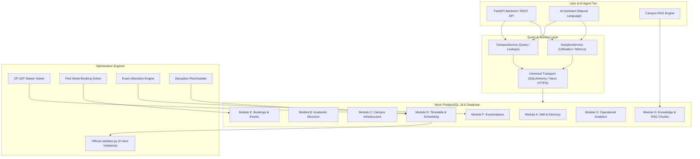
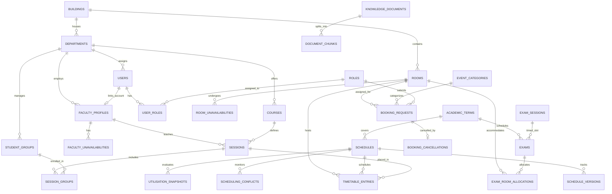

# CITRIX PostgreSQL Database Architecture & Entity-Relationship Specification

## 1. Executive Architecture Summary

CITRIX uses hosted **Neon Serverless PostgreSQL (PostgreSQL 18.6)** as the central state and operational intelligence layer connecting five key components:
1. **Google OR-Tools CP-SAT Scheduling Engine:** Generates and repairs master timetables, Fest Week bookings, and exam allocations.
2. **Deterministic Validation Pipeline:** Directly validated by `CrunchWeek_StarterPack/validator.py` (0 hard constraint violations).
3. **AI Assistant & Agent Tools:** Natural-language queries, room availability lookups, timetable inspections, and capacity checks via deterministic, read-only and confirmed interfaces.
4. **Institutional Knowledge & RAG:** Semantic chunk storage, document attribution, and keyword indexing for campus policies and regulations.
5. **FastAPI Backend Services:** Parameterized queries, connection pooling, and analytics snapshots.

---

## 2. Complete Entity-Relationship (ER) Diagram

---

## 3. Relational Schema Modules

### Module A: Identity & Access Management (IAM)
- **`roles`** (7 rows): Role tiers (`admin`, `faculty`, `department_coordinator`, `club`, `dean`, `hod`, `student`) with associated `category_cap` ceiling.
- **`departments`** (10 rows): Academic departments (`CSE`, `ECE`, `EE`, `ME`, `CE`, `HSS`, `MA`, `PH`, `ADMIN`, `COMMON`) linked to primary buildings.
- **`users`** (45 rows): Accounts for faculty members and administrative leads with email addresses and department affiliations.
- **`user_roles`** (45 rows): Composite primary key (`user_id`, `role_id`).
- **`faculty_profiles`** (40 rows): Academic constraints (`max_hours_per_day = 4`, accessibility requirements, and soft preference lists).
- **`faculty_unavailabilities`** (95 rows): Day and period exclusions preserving hard constraint H3.
- **`student_groups`** (14 rows): Student cohorts (`Y1-A`..`Y1-D`, `CSE-2`..`CSE-4`, etc.) with sizes and accessibility requirements.

### Module B: Academic Structure
- **`academic_terms`** (1 row): Active term record (`cit-public-v1`, Fest Week 7).
- **`academic_periods`** (13 rows): Periods P1 through P13 with exact start/end times, teaching flags (P1-P9), and event flags (P10-P13).
- **`courses`** (62 rows): Course catalog with lecture hours, tutorial hours, and 3-hour lab block counts.

### Module C: Campus Infrastructure
- **`buildings`** (12 rows): Unique physical locations with lift accessibility indicators.
- **`rooms`** (27 rows): Preserves canonical IDs (`AUD`, `LH-1`..`LH-4`, `CR-101`..`CR-204`, etc.), with total capacity, strict alternate-seat exam capacity (`capacity // 2`), and equipment features.
- **`room_unavailabilities`** (13 rows): Maintenance and administrative exclusions (e.g. LH-4 ceiling maintenance).

### Module D: Timetable & Scheduling
- **`sessions`** (189 rows): Teaching sessions with duration, kind (lecture/tutorial/lab), faculty FK, course FK, and basket synchronization slots (`OEB-1`, `OEB-2`, `OEB-3`).
- **`session_groups`** (240 rows): Composite mapping connecting multi-group sessions with student cohorts.
- **`schedules`** (1 row): Master baseline schedule (`cit-baseline-schedule`) recording solver score, runtime, and 0 hard constraint violations.
- **`schedule_versions`** (1 row): Versioning audit history.
- **`timetable_entries`** (189 rows): Assigned slots (`day`, `start_period`, `end_period`, `room_id`) with Fest Week override tracking.

### Module E: Bookings & Campus Events
- **`event_categories`** (4 rows): Weights and priority rankings (`institute_event`: 5, `guest_lecture`: 4, `department_event`: 3, `club_event`: 2).
- **`booking_requests`** (25 rows): Submitted event requests, with effective category clamped to requester role cap.
- **`booking_cancellations`** (1 row): Audit record for cancelled booking (`BR-04`).

### Module F: Examinations
- **`exam_sessions`** (2 rows): Morning (`AM`) and Afternoon (`PM`) sessions.
- **`exams`** (41 rows): Examination slots assigned to days and sessions.
- **`exam_room_allocations`** (51 rows): Alternate-seating room allocations respecting exam capacities.

### Module G: Operational Analytics & Monitoring
- **`audit_logs`**: System event tracking for timetable generation and rescheduling.
- **`notifications`**: Targeted notifications for administrative reviews.
- **`scheduling_conflicts`**: Disruption impact and constraint violation tracking.
- **`utilisation_snapshots`**: Weekly building and room utilization analytics.

### Module H: Knowledge & RAG Documents
- **`knowledge_documents`** (3 rows): Master README, scheduling regulations, and sample requests.
- **`document_chunks`** (38 rows): Semantic text chunks indexed with keywords and markdown headers.

---

## 4. Dual Transport & Network Resilience Architecture

In enterprise and academic networks, direct outbound raw TCP on port 5432 is frequently blocked or reset by local firewalls (`WinError 10054`). CITRIX implements a dual-transport query architecture:

1. **Standard TCP Transport (Port 5432):** Sized for cloud deployments (Docker, Railway, Render, AWS ECS). Configured with connection pooling:
   - `pool_pre_ping=True`: Immediate health-check prior to checkout.
   - `pool_recycle=300`: Periodic recycle to avoid stale cloud sockets.
   - `pool_size=5`, `max_overflow=10`.
2. **Neon Cloud HTTPS Transport (Port 443):** When port 5432 TCP is reset by local network boundaries, the system routes queries through `https://<host>/sql` over TLS port 443.
3. **Transparent Execution (`execute_query`):** Services call `execute_query(sql, params)`, which automatically selects, tests, and caches the working transport without application code needing to manage networking specifics.

---

## 5. Verification & Official Validator Compliance

The database schema and ingested data are verified against:
- **Alembic Schema Migrations:** Revision `001_initial_citrix_schema` applied and stamped in `alembic_version`.
- **Database Row Count Audit:** 1,169 total rows verified across all 26 relational tables.
- **Pytest Database Integration Suite:** 12 passed tests in `tests/test_database_integration.py`.
- **Official Competition Validator (`validator.py`):**
  - Hard constraint violations: **0**
  - Exam soft penalty: **0**
  - Priority inversions: **0**
  - Fest Week approved bookings: **21 approved, 2 alternatives offered**
