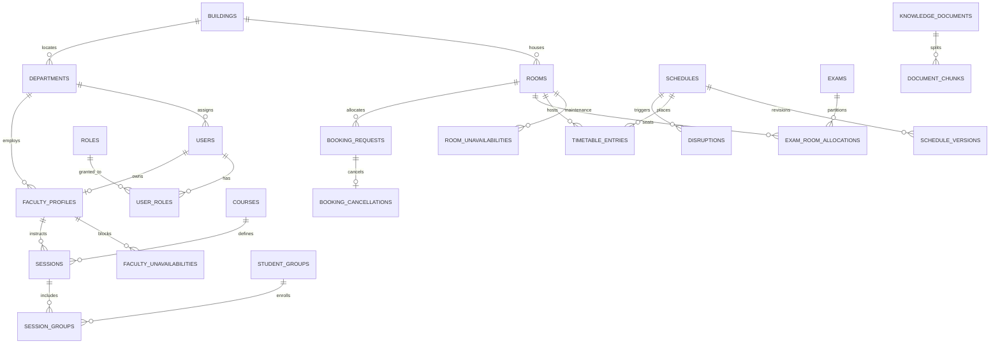
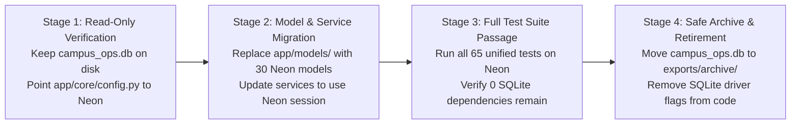

# CITRIX — Database Consolidation & Migration Plan

**Document Version:** 1.0.0  
**Status:** Approved Architectural Blueprint (Pre-Implementation)  
**Authoritative Single Source of Truth:** Neon Serverless PostgreSQL 18.6  
**Retirement Target:** Local SQLite (`campus_ops.db` and `test_campus_ops.db`)

---

## 1. Executive Consolidation Summary

CITRIX will standardize exclusively on **Neon Serverless PostgreSQL 18.6**.
- **Existing Baseline:** 30 normalized relational tables in Neon containing 1,169 canonical records ingested from `cit_public.json` under Alembic migration `001_initial_citrix_schema`.
- **Target Consolidation:** The SQLite implementation in the root project (`app/models/`) contains 10 tables that denormalize relational structures into JSON columns. These 10 models will be replaced by the 30 canonical PostgreSQL models.
- **Critical Schema Alignment:** To support the application's JWT authentication, anti-self-approval auditing, and disruption workflow without breaking existing canonical data, an incremental Alembic migration (`002_application_alignment`) will be drafted to add required authentication and tracking columns.

---

## 2. Table-by-Table Architectural Comparison

| Domain Area | Canonical Neon PostgreSQL Table (30 Tables) | SQLite Implementation (`app/models/`) | Decision & Consolidation Strategy |
| :--- | :--- | :--- | :--- |
| **User Identity** | `users` (id, email, full_name, department_code, is_active, timestamps) | `users` (id, username, email, hashed_password, name, role, department, faculty_id, student_group_id, club_name, is_active, last_login_at) | **Retain Neon `users` as master.** Add `hashed_password` (VARCHAR 256), `username` (VARCHAR 64 UNIQUE), and `last_login_at` (TIMESTAMPTZ) to support JWT auth. Role mapping is handled via normalized `user_roles`. |
| **Roles & RBAC** | `roles` (id, name, description, category_cap) + `user_roles` (user_id, role_id) | Direct string enum `role` in `users` | **Retain Neon `roles` and `user_roles`.** Canonical roles: `admin`, `department_coordinator`, `faculty`, `club`, `student`, `dean`, `hod`. |
| **Departments** | `departments` (code, name, building_id) | Raw string in `faculty` and `courses` | **Retain Neon `departments`.** Foreign keys enforce departmental integrity across faculty, courses, and student groups. |
| **Faculty Profile** | `faculty_profiles` (id, user_id, name, department_code, max_hours_per_day, needs_accessible, preferences) | `faculty` (id, name, department, max_hours_per_day, needs_accessible, unavailable [JSON], preferences [JSON]) | **Retain Neon `faculty_profiles`.** Replaces denormalized SQLite `faculty` table. |
| **Faculty Unavailabilities** | `faculty_unavailabilities` (id, faculty_id, day, period, reason, is_permanent) — 95 rows | Embedded JSON column `unavailable` in `faculty` | **Retain Neon `faculty_unavailabilities`.** Eliminates Python-side JSON parsing; enables SQL index lookups during timetable constraint checks. |
| **Student Groups** | `student_groups` (id, name, year, department_code, size, needs_accessible) | `student_groups` (id, name, year, department, size, needs_accessible) | **Retain Neon `student_groups`.** Preserves canonical FK `department_code -> departments.code`. |
| **Academic Terms & Periods** | `academic_terms` (id, name, is_current, fest_week_number) + `academic_periods` (period_number P1–P13, times, is_teaching, is_event_only) | Hardcoded period constants in Python | **Retain Neon `academic_terms` and `academic_periods`.** Canonical time boundary definitions. |
| **Courses** | `courses` (id, title, department_code, year, lecture_hours, tutorial_hours, lab_blocks) | `courses` (id, name, department, lecture_hours, tutorial_hours, lab_blocks) | **Retain Neon `courses`.** Column is canonically named `title`. |
| **Campus Infrastructure** | `buildings` (id, name, code, has_lift) + `rooms` (id, name, building_id, type, capacity, exam_capacity, accessible, features, allowed_uses) | `rooms` (id, name, building [String], type, capacity, features [JSON], accessible, allowed_uses [JSON]) | **Retain Neon `buildings` and `rooms`.** Enforces building foreign keys and canonical `exam_capacity = capacity // 2`. |
| **Room Unavailabilities** | `room_unavailabilities` (id, room_id, day, period, reason, is_permanent) — 13 rows | `room_unavailabilities` (id, room_id, day, periods [JSON], reason) | **Retain Neon `room_unavailabilities`.** Normalized 1 row per period slot with composite index `(room_id, day, period)`. |
| **Academic Sessions** | `sessions` (id, course_id, kind, faculty_id, size, duration, room_types, needs_accessible, basket_slot, fixed_slot_day, fixed_slot_period) + `session_groups` (240 rows) | `sessions` (id, course_id, kind, groups [JSON], faculty_id, size, duration, room_types [JSON], needs_accessible, basket_slot, fixed_slot [JSON]) | **Retain Neon `sessions` and `session_groups`.** Normalized many-to-many relationship for multi-group lecture sessions. |
| **Timetable Placements** | `schedules` + `schedule_versions` + `timetable_entries` (189 rows) | `schedule_versions` + `scheduled_sessions` | **Retain Neon `schedules`, `schedule_versions`, and `timetable_entries`.** Standardizes master schedule storage and tracks solver runtime and violations count. |
| **Spectra Week Bookings** | `booking_requests` (id, submitted_at, requester, role, department_code, requested_category, effective_category, title, attendance, duration_periods, windows, room_types, needs, requested_room, mandatory_for_groups, series_id, status, assigned_room_id, assigned_day, assigned_start_period, assigned_end_period, decision_reason) + `booking_cancellations` | `booking_requests` (includes `requester_user_id`, `decided_by_user_id`, `decided_at`) | **Retain Neon `booking_requests` and `booking_cancellations`.** Add columns `requester_user_id` (VARCHAR 64), `decided_by_user_id` (VARCHAR 64), and `decided_at` (TIMESTAMPTZ) to satisfy anti-self-approval auditing. |
| **Midterm Examinations** | `exam_sessions` (AM/PM) + `exams` (41 rows) + `exam_room_allocations` (51 seat allocation rows) | `exams` (stores rooms as JSON list `["AUD", "LH-1"]`) | **Retain Neon `exam_sessions`, `exams`, and `exam_room_allocations`.** Accurately tracks seat count allocations per venue under alternate-seating rules. |
| **Emergency Disruptions** | `scheduling_conflicts` + `schedule_versions.disruption_payload` | `disruptions` (id, submitted_by_user_id, disruption_type, payload [JSON], status, impact_summary, proposed_schedule_id, approved_by_user_id) | **Incorporate `disruptions` table into Neon.** Serves as the operational staging workflow table for leave requests and maintenance closures before CP-SAT rescheduling is applied. |
| **System Audit Logs** | `audit_logs` (id, user_id, action, entity_type, entity_id, details, created_at) | `audit_logs` (id, actor_id, actor_role, action, entity_type, entity_id, status, details, ip_address, created_at) | **Enrich Neon `audit_logs`.** Add `actor_role` (VARCHAR 32), `status` (VARCHAR 32, default 'SUCCESS'), and `ip_address` (VARCHAR 64) for enhanced compliance auditing. |
| **Notifications** | `notifications` (id, user_id, role_target, title, message, is_read, created_at) | `notifications` (id, user_id, title, message, type, is_read) | **Retain Neon `notifications`.** |
| **Operational Analytics** | `utilisation_snapshots` (id, schedule_id, snapshot_date, building_id, room_id, total_slots, occupied_slots, utilisation_pct, metrics) | Calculated dynamically in Python | **Retain Neon `utilisation_snapshots`.** Provides fast snapshots for Dean's Office analytics dashboards. |
| **Knowledge Base (RAG)** | `knowledge_documents` + `document_chunks` (38 pre-indexed semantic chunks) | `knowledge_documents` (raw_content, access_role_minimum) | **Combine into Neon `knowledge_documents`.** Add `access_role_minimum` (VARCHAR 32, default 'student') and `raw_content` (TEXT) to `knowledge_documents`. Retain `document_chunks`. |

---

## 3. Schema Delta Specification: Alembic Migration `002_application_alignment`

The following schema additions will be introduced in migration `002` to achieve 100% application feature parity without mutating any of the 1,169 existing rows in Neon:

```sql
-- 1. Identity & Auth Extension on users table
ALTER TABLE users 
    ADD COLUMN IF NOT EXISTS username VARCHAR(64) UNIQUE,
    ADD COLUMN IF NOT EXISTS hashed_password VARCHAR(256),
    ADD COLUMN IF NOT EXISTS last_login_at TIMESTAMP WITH TIME ZONE;

CREATE INDEX IF NOT EXISTS ix_users_username ON users (username);

-- 2. Anti-Self-Approval & Decision Audit Extension on booking_requests table
ALTER TABLE booking_requests 
    ADD COLUMN IF NOT EXISTS requester_user_id VARCHAR(64) REFERENCES users(id) ON DELETE SET NULL,
    ADD COLUMN IF NOT EXISTS decided_by_user_id VARCHAR(64) REFERENCES users(id) ON DELETE SET NULL,
    ADD COLUMN IF NOT EXISTS decided_at TIMESTAMP WITH TIME ZONE;

CREATE INDEX IF NOT EXISTS ix_booking_requests_requester_user ON booking_requests (requester_user_id);
CREATE INDEX IF NOT EXISTS ix_booking_requests_decided_by ON booking_requests (decided_by_user_id);

-- 3. Staging Workflow Table for Schedule Disruptions
CREATE TABLE IF NOT EXISTS disruptions (
    id SERIAL PRIMARY KEY,
    submitted_by_user_id VARCHAR(64) REFERENCES users(id) ON DELETE SET NULL,
    disruption_type VARCHAR(64) NOT NULL,
    payload JSONB NOT NULL,
    status VARCHAR(32) NOT NULL DEFAULT 'pending',
    impact_summary JSONB DEFAULT '{}'::jsonb,
    proposed_schedule_id VARCHAR(64) REFERENCES schedules(id) ON DELETE SET NULL,
    approved_by_user_id VARCHAR(64) REFERENCES users(id) ON DELETE SET NULL,
    created_at TIMESTAMP WITH TIME ZONE NOT NULL DEFAULT CURRENT_TIMESTAMP,
    updated_at TIMESTAMP WITH TIME ZONE NOT NULL DEFAULT CURRENT_TIMESTAMP
);

CREATE INDEX IF NOT EXISTS ix_disruptions_status ON disruptions (status);
CREATE INDEX IF NOT EXISTS ix_disruptions_submitted_by ON disruptions (submitted_by_user_id);

-- 4. Audit Log Enhancement
ALTER TABLE audit_logs 
    ADD COLUMN IF NOT EXISTS actor_role VARCHAR(32),
    ADD COLUMN IF NOT EXISTS status VARCHAR(32) DEFAULT 'SUCCESS',
    ADD COLUMN IF NOT EXISTS ip_address VARCHAR(64);

-- 5. Knowledge Document Access Role Minimum
ALTER TABLE knowledge_documents 
    ADD COLUMN IF NOT EXISTS access_role_minimum VARCHAR(32) DEFAULT 'student',
    ADD COLUMN IF NOT EXISTS raw_content TEXT;
```

---

## 4. Foreign Key & Constraint Integrity Matrix



### Unique Constraints & Critical Composite Indexes
1. `uq_faculty_unavailability_slot`: `UNIQUE (faculty_id, day, period)` on `faculty_unavailabilities`.
2. `uq_room_unavailability_slot`: `UNIQUE (room_id, day, period)` on `room_unavailabilities`.
3. `uq_schedule_session`: `UNIQUE (schedule_id, session_id)` on `timetable_entries`.
4. `uq_exam_room_allocation`: `UNIQUE (exam_id, room_id)` on `exam_room_allocations`.
5. `uq_schedule_version`: `UNIQUE (schedule_id, version_number)` on `schedule_versions`.
6. `idx_timetable_room_day_start`: Composite index on `(schedule_id, room_id, day, start_period)` for sub-millisecond room clash lookups.
7. `idx_doc_chunk_doc_idx`: Index on `(document_id, chunk_index)` on `document_chunks`.

---

## 5. Data Migration Strategy from SQLite to Neon

Because Neon PostgreSQL already contains the canonical dataset of 1,169 records, **domain data (rooms, courses, faculty, student groups, sessions, baseline schedules, baseline exams, baseline bookings) DOES NOT need to be copied from SQLite.**

### Specific Data Elements to Seed in Neon:
1. **Initial Admin & Persona Accounts:**
   - Seed hashed passwords (`bcrypt`) for the 5 competition personas so that the JWT login endpoint (`/api/v1/auth/login`) functions out of the box:
     - `admin` (`admin@cit.ac.in`) $\to$ `RoleEnum.ADMIN`
     - `coordinator_cse` (`coord_cse@cit.ac.in`) $\to$ `RoleEnum.DEPARTMENT_COORDINATOR`
     - `f01_faculty` (`f01@cit.ac.in`) $\to$ `RoleEnum.FACULTY`
     - `club_robotics` (`robotics@cit.ac.in`) $\to$ `RoleEnum.CLUB`
     - `student_cse2` (`student_cse2@cit.ac.in`) $\to$ `RoleEnum.STUDENT`
2. **Initial Disruption Staging State:**
   - Any active test disruptions from SQLite will be seeded into `disruptions`.
3. **Audit Log Continuity:**
   - Past audit entries from SQLite will be backfilled into Neon's `audit_logs` if persistent history preservation is required, or initialized fresh for the unified platform.

---

## 6. SQLite Safe Decommissioning Procedure

To prevent premature data loss or broken test dependencies, SQLite files will be retired in 4 guarded stages:



1. **Phase A (Current):** SQLite files remain intact on disk. No files are deleted.
2. **Phase B (Schema Alignment):** Apply migration `002_application_alignment` to Neon. Update `app/core/config.py` to point to Neon PostgreSQL.
3. **Phase C (Integration Verification):** Run the complete unified test suite against Neon PostgreSQL.
4. **Phase D (Retirement):** Only after 100% test passage is verified, archive `campus_ops.db` into `exports/archive/` and delete from the active workspace root.
