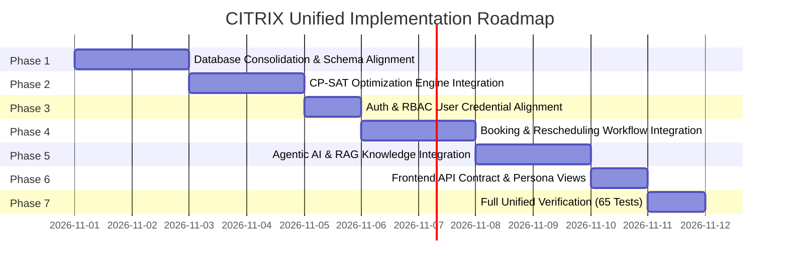

# CITRIX — Step-by-Step Implementation Roadmap

**Document Version:** 1.0.0  
**Status:** Approved Architectural Blueprint (Pre-Implementation)  
**Execution Method:** Phased, Independently Verifiable Increments with Guarded Rollback Strategies

---

## 1. Roadmap Overview & Timeline

The integration transitions CITRIX from two separate folders into a unified, high-performance platform over 7 sequential phases:

---

## 2. Detailed Phase Specifications

### Phase 1: Database Consolidation & Schema Alignment
- **Objective:** Establish Neon Serverless PostgreSQL as the sole database. Implement Alembic migration `002_application_alignment` to add auth columns and staging workflow tables. Replace SQLite models in `app/models/` with canonical models from `CITRIX/CITRIX/api/models.py`.
- **Files Affected:**
  - `requirements.txt`, `pyproject.toml` (add `psycopg2-binary`, `alembic`, `ortools`, `python-dotenv`)
  - `app/core/config.py` (update `DATABASE_URL` default to PostgreSQL)
  - `app/core/database.py` (port connection pooling and dual-transport logic from `CITRIX/CITRIX/api/database.py`)
  - `app/models/` (replace 10 SQLite models with 30 canonical models)
  - `alembic/versions/002_application_alignment.py` (create migration script)
- **Dependencies:** Active Neon PostgreSQL deployment; Alembic migration `001_initial_citrix_schema` baseline.
- **Expected Output:** `app/core/database.py` connects to Neon with connection pooling; `Base.metadata` matches 30 canonical tables + auth columns.
- **Tests Required:** `CITRIX/CITRIX/tests/test_database.py` (3 tests) and `test_database_integration.py` (12 tests).
- **Acceptance Criteria:** `SELECT count(*) FROM rooms` returns 27; `SELECT count(*) FROM faculty_profiles` returns 40; all 15 DB tests pass against Neon.
- **Rollback Strategy:** Revert `app/core/database.py` and `config.py` to local SQLite configuration; existing Neon data is untouched as migration `002` only adds columns.

---

### Phase 2: CP-SAT Optimization Engine Integration
- **Objective:** Move the standalone Google OR-Tools CP-SAT engines into `app/engine/` and connect `app/api/v1/endpoints/schedules.py` to generate conflict-free academic timetables with 0 hard violations.
- **Files Affected:**
  - Copy `CITRIX/CITRIX/engine/` $\to$ `app/engine/`
  - `app/services/timetable_service.py` (wire to `app.engine.scheduler.solver.generate_timetable`)
  - `app/api/v1/endpoints/schedules.py` (replace stub generator with CP-SAT call and persistence)
  - `app/services/validator_service.py` (wire to `app.engine.scheduler.validator_adapter`)
- **Dependencies:** Phase 1 complete (`requirements.txt` includes `ortools`).
- **Expected Output:** `POST /api/v1/schedules/generate` solves the 189-session timetable in < 20 seconds, records 0 hard constraint violations, and persists to `schedules` and `timetable_entries`.
- **Tests Required:** `test_timetable_solver.py` (1 test), `test_s2_regression.py` (8 tests), `test_data_loader.py` (3 tests).
- **Acceptance Criteria:** `exports/schedule.json` validated by `CrunchWeek_StarterPack/validator.py` with `hard_violations_count == 0`.
- **Rollback Strategy:** Retain existing `schedules.py` stub until solver integration tests pass.

---

### Phase 3: Authentication & RBAC User Credential Alignment
- **Objective:** Seed the 5 persona accounts (`admin`, `coordinator`, `faculty`, `club`, `student`) with bcrypt hashed passwords into the canonical `users` table on Neon and verify JWT login, token issuance, and role permissions.
- **Files Affected:**
  - `app/core/security.py`, `app/core/rbac.py`
  - `app/api/v1/endpoints/auth.py`
  - `app/schemas/auth.py`
  - Database seed script `scripts/seed_auth_users.py`
- **Dependencies:** Phase 1 complete (migration `002` has added `hashed_password` and `username` columns).
- **Expected Output:** `POST /api/v1/auth/login` verifies user passwords and issues signed HS256 JWT tokens with role claims.
- **Tests Required:** `tests/test_auth.py` (3 tests) and `tests/test_rbac.py` (2 tests).
- **Acceptance Criteria:** All 5 competition roles authenticate successfully; invalid passwords return HTTP 401; protected dashboard routes reject unauthorized tokens.
- **Rollback Strategy:** Delete seeded test rows from `users` if authentication errors occur.

---

### Phase 4: Venue Booking & Disruption Approval Workflows
- **Objective:** Connect Spectra Fest Week booking evaluations and disruption rescheduling engines to the application APIs with strict anti-self-approval enforcement.
- **Files Affected:**
  - `app/services/booking_service.py` (wire to `app.engine.fest.engine.FestWeekEngine`)
  - `app/services/disruption_service.py` (wire to `app.engine.rescheduler.engine.reschedule`)
  - `app/api/v1/endpoints/bookings.py` (enforce category caps and anti-self-approval)
  - `app/api/v1/endpoints/reschedule.py` (wire to disruption rescheduler)
  - `app/api/v1/endpoints/exams.py` (wire to `ExamScheduler`)
- **Dependencies:** Phase 2 and Phase 3 complete.
- **Expected Output:**
  - Booking approvals enforce `enforce_no_self_approval()`.
  - Disruption requests simulate affected sessions and minimal-displacement repairs.
  - Exam scheduling enforces alternate seating (`capacity // 2`).
- **Tests Required:** `tests/test_approval_security.py` (3 tests), `tests/test_data_isolation.py` (3 tests), `test_fest_bookings.py` (1 test), `test_exam_scheduler.py` (1 test), `test_rescheduler.py` (1 test).
- **Acceptance Criteria:** Self-approval attempts return HTTP 400; coordinator cannot approve non-department venues; rescheduler achieves 0 hard violations on repaired timetable.
- **Rollback Strategy:** Transaction rollback on `disruptions` and `booking_requests` preserves initial baseline schedule.

---

### Phase 5: Agentic AI & RAG Knowledge Integration
- **Objective:** Re-point all 10 tools in `app/ai/agent/tools.py` to query the consolidated PostgreSQL tables and application services. Connect RAG retrieval to query Neon's `knowledge_documents` and `document_chunks`.
- **Files Affected:**
  - `app/ai/agent/tools.py` (update ORM queries for `rooms`, `timetable_entries`, `faculty_unavailabilities`)
  - `app/ai/rag/retrieval_service.py` (sync with Neon document chunk tables)
  - `app/api/v1/endpoints/assistant.py` (confirm-action and dean-insights endpoints)
- **Dependencies:** Phase 1 through 4 complete.
- **Expected Output:**
  - Natural language queries in English and Hinglish execute live database lookups.
  - State-modifying actions return `requires_confirmation: true` and execute only upon valid confirmation token submission.
  - Dean's AI insights endpoint returns real-time utilization metrics from Neon.
- **Tests Required:** `tests/test_citrix_agent.py` (5 tests), `tests/test_agent_scenarios.py` (3 tests), `tests/test_ai_security.py` (4 tests), `tests/test_citrix_rag.py` (4 tests), `tests/test_rag_evaluation.py` (1 test).
- **Acceptance Criteria:** Prompt injection attempts are neutralized; confidential policies are filtered by role; AI confirmations execute cleanly against Neon.
- **Rollback Strategy:** Fallback mock LLM mode in `llm_factory.py` ensures test passage even in offline environments.

---

### Phase 6: Frontend API Contract & Persona Views Verification
- **Objective:** Verify that all 5 role dashboard endpoints (`/api/v1/dashboards/{role}`) and timetable matrix endpoints adhere strictly to the JSON schema contracts required by modern web/mobile frontends.
- **Files Affected:**
  - `app/api/v1/endpoints/dashboards.py`
  - `app/schemas/dashboard.py`
  - `app/schemas/timetable.py`
- **Dependencies:** Phase 1 through 5 complete.
- **Expected Output:** Dean, Coordinator, Faculty, Club, and Student dashboards return populated JSON payloads containing utilization metrics, schedule tables, and status notifications.
- **Tests Required:** `tests/test_rbac.py`, `tests/test_data_isolation.py`.
- **Acceptance Criteria:** Zero 500 Internal Server Errors; student dashboard excludes other student groups; faculty dashboard excludes other faculty.

---

### Phase 7: Full Unified Verification & SQLite Decommissioning
- **Objective:** Run the consolidated test suite of all 65 tests against Neon Serverless PostgreSQL. Archive and retire SQLite database files.
- **Files Affected:**
  - `tests/` (all 65 unified tests active)
  - `campus_ops.db` (moved to `exports/archive/`)
  - `test_campus_ops.db` (removed)
- **Dependencies:** All previous phases complete and verified.
- **Expected Output:** **65 passed out of 65 tests** in pytest.
- **Acceptance Criteria:** Zero hard violations on `validator.py`; zero SQLite references remaining in production code; all competition requirements satisfied.
- **Rollback Strategy:** Archived copy of `campus_ops.db` retained in `exports/archive/` for emergency reference.
