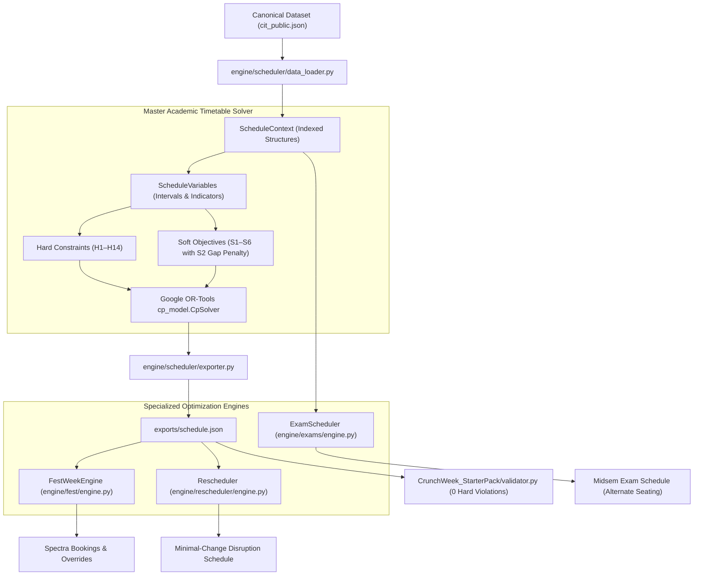
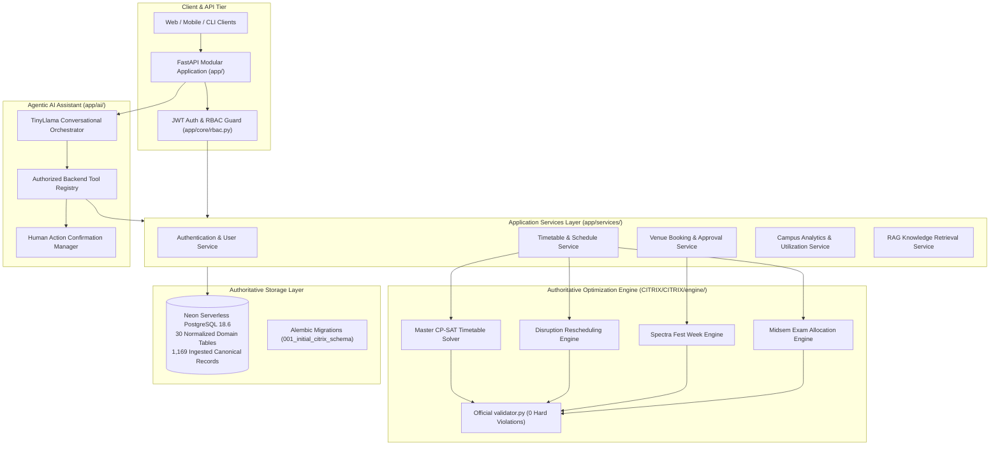

# CITRIX — Full Codebase Audit & Unified Integration Blueprint

**Date:** October 31, 2026  
**Status:** Complete Read-Only Analysis (Awaiting User Implementation Approval)  
**Security Notice:** All credentials, connection strings, and sensitive secrets are strictly masked/redacted in this report.

---

## Executive Summary

The workspace contains two distinct, high-quality implementations:

1. **`CITRIX/CITRIX` (The Intelligence Engine & Production Data Layer):**
   - **Database:** Hosted **Neon Serverless PostgreSQL 18.6** with 30 fully normalized domain tables and 1,169 canonical records ingested from `CrunchWeek_StarterPack/data/cit_public.json`.
   - **Database Architecture:** Alembic migration history (`001_initial_citrix_schema`), connection pooling (`pool_pre_ping=True`, `pool_recycle=300`), and a resilient dual-transport query adapter (SQLAlchemy TCP 5432 with fallback to Neon Cloud HTTPS 443).
   - **Deterministic Solvers:** Google OR-Tools CP-SAT engines for academic timetable generation (0 hard constraint violations), Spectra Fest Week event scheduling with role category caps, midterm examination scheduling with alternate seating (`capacity // 2`), and stability-optimized disruption rescheduling.
   - **Validator:** Fully integrated with `CrunchWeek_StarterPack/validator.py`.
   - **Test Suite:** 36 passing tests verifying database integration, solvers, regression, and data loading.

2. **Root Workspace `.` (CampusOS Application, RBAC & Agentic AI Layer):**
   - **Application Tier:** FastAPI modular backend (`app/`) with JWT Bearer authentication, bcrypt hashing, and comprehensive Role-Based Access Control (RBAC) supporting 5 roles (`ADMIN`, `DEPARTMENT_COORDINATOR`, `FACULTY`, `CLUB`, `STUDENT`).
   - **Security Safeguards:** Hardened anti-self-approval enforcement for venue bookings and schedule disruptions, category capping, and tamper-evident audit logging (`audit_logs`).
   - **Agentic AI & RAG:** Multi-turn conversational assistant powered by `TinyLlama/TinyLlama-1.1B-Chat-v1.0` via `langchain_huggingface` with English/Hinglish entity extraction, 10 registered backend tools, Human-in-the-Loop action confirmation tokens, hybrid vector store (BM25 + dense embeddings), role-filtered retrieval, source citations, prompt-injection sanitization, and automated RAG evaluation.
   - **Database:** SQLite implementation (`campus_ops.db` and `test_campus_ops.db`) with denormalized JSON columns.
   - **Test Suite:** 29 passing tests covering RBAC, auth, data isolation, agent workflows, and AI security.

**Core Architectural Mandate:**
- **Neon PostgreSQL is the sole authoritative database to be retained.**
- **The SQLite database and its denormalized schema are to be systematically decommissioned.**
- **The standalone Google OR-Tools CP-SAT engine is the sole authoritative scheduling engine.**
- **The FastAPI application, RBAC security layer, and Agentic AI assistant will be wired directly to Neon PostgreSQL and the CP-SAT engine.**

---

## Phase 1 — Repository Structure & Inventory

### 1. Actual Folder Layout
The root directory (`C:\Users\user\Desktop\Tech_Zephyr4`) hosts both codebases:
```
Tech_Zephyr4/
├── CITRIX/                             # My Project — Intelligence Engine & Neon DB
│   └── CITRIX/
│       ├── ai/                         # Prototype AI & RAG scripts
│       ├── alembic/                    # Alembic environment and version 001 migration
│       ├── api/                        # FastAPI entry point, Neon models & campus services
│       ├── CrunchWeek_StarterPack/     # Competition dataset, validator.py, and samples
│       ├── docs/                       # Architecture, DB schema, scheduling rules specs
│       ├── engine/                     # Google OR-Tools CP-SAT Solvers (Master, Exams, Fest, Rescheduler)
│       ├── exports/                    # Validated schedules (schedule.json) and evaluation logs
│       ├── scripts/                    # Ingestion, validation, DB audit & pipeline scripts
│       ├── tests/                      # 36 tests (engine, DB integration, S2 parity)
│       ├── alembic.ini                 # Migration configuration
│       └── .env.example                # Redacted template
├── app/                                # Friend's Project — Application & AI Backend
│   ├── ai/                             # Advanced Agentic AI, Tool Registry, RAG & Evaluation
│   ├── api/v1/                         # Modular FastAPI routers (auth, timetable, bookings, dashboards)
│   ├── core/                           # Config, JWT security, RBAC permissions, audit logger
│   ├── models/                         # SQLite SQLAlchemy ORM models (10 files)
│   ├── schemas/                        # Pydantic schemas for requests, responses, auth, dashboards
│   └── services/                       # Business logic services (timetable, bookings, data loader)
├── docs/                               # AI architecture, API contracts, security test reports
├── exports/                            # Exported schedule files
├── tests/                              # 29 tests (RBAC, security, agent scenarios, RAG benchmarks)
├── campus_ops.db                       # Friend's local SQLite database (404 KB)
├── test_campus_ops.db                  # Test SQLite database (416 KB)
├── requirements.txt                    # Root application Python requirements
└── pyproject.toml                      # Root project configuration and pytest settings
```

### 2. Entry Points & Key Modules

| Component | `CITRIX/CITRIX` (Intelligence Engine) | Root `app/` (CampusOS Application) |
| :--- | :--- | :--- |
| **Primary Entry Point** | `api/main.py` (`uvicorn api.main:app`) | `app/main.py` (`uvicorn app.main:app`) |
| **Database Engine** | `api/database.py` (Neon PostgreSQL TCP/HTTPS) | `app/core/database.py` (SQLite `campus_ops.db`) |
| **ORM Models** | `api/models.py` (30 normalized domain models) | `app/models/*.py` (10 models with JSON columns) |
| **Alembic Migrations** | `alembic/versions/001_initial_citrix_schema.py` | None (Uses `Base.metadata.create_all`) |
| **Optimization Engines** | `engine/scheduler/solver.py`, `engine/exams/engine.py`, `engine/fest/engine.py`, `engine/rescheduler/engine.py` | None (Mock/placeholder placements in `schedules.py`) |
| **Authentication & RBAC** | None (Raw user accounts in DB) | `app/core/security.py`, `app/core/rbac.py` (Full JWT + 5 Roles) |
| **AI Assistant & Agent** | `ai/assistant/assistant.py` (Pattern-based) | `app/ai/agent/orchestrator.py` (TinyLlama + Tool Registry + Confirmations) |
| **RAG Implementation** | `ai/rag/pipeline.py` (PostgreSQL Chunks query) | `app/ai/rag/retrieval_service.py` (Hybrid BM25 + Embeddings + Citations) |

---

## Phase 2 — Full Backend & Database Audit

### 1. Side-by-Side Schema Comparison: Neon PostgreSQL vs. SQLite

| Architectural Area | `CITRIX/CITRIX` (Neon PostgreSQL 18.6) | Root `app/` (Friend's SQLite Implementation) | Architectural Gap & Required Action |
| :--- | :--- | :--- | :--- |
| **Connection Config** | `api/database.py`: Neon pooling (`pool_pre_ping=True`, `pool_recycle=300`, `pool_size=5`), SSL mode `require`, dual-transport TCP (5432) & HTTPS (443). | `app/core/database.py`: `create_engine(DATABASE_URL, connect_args={"check_same_thread": False})`. Default: `sqlite:///./campus_ops.db`. | Retire SQLite engine. Port Neon connection pooling and HTTPS fallback to `app/core/database.py`. |
| **ORM Models Location** | Single comprehensive `api/models.py` (552 lines). | 10 separate files in `app/models/` (`base.py`, `user.py`, `room.py`, `faculty.py`, `booking.py`, etc.). | Replace `app/models/` definitions with the authoritative 30 domain models from `api/models.py`. |
| **Total Tables** | **30 Tables** fully normalized. | **10 Tables** denormalized. | 20 tables are missing in SQLite (e.g. `academic_periods`, `event_categories`, `session_groups`, `exam_room_allocations`, `faculty_unavailabilities`, etc.). |
| **User & IAM Models** | Normalized across `roles`, `departments`, `users`, `user_roles`, `faculty_profiles`. No plaintext passwords. | Single `users` table containing `hashed_password`, `role` (enum string), `department`, `faculty_id`, `student_group_id`. | Merge JWT auth fields (`hashed_password`, `last_login_at`) into the canonical `users` table or an auth credential extension. |
| **Faculty Unavailability**| Normalized table `faculty_unavailabilities` with 95 rows: composite key `(faculty_id, day, period)`. | Denormalized JSON column `unavailable` inside `faculty` table (`[{"day": "WED", "periods": [...]}]`). | Update queries and services to query `faculty_unavailabilities` instead of unpacking JSON in Python. |
| **Room Infrastructure** | `rooms` has FK `building_id -> buildings.id`, strict `exam_capacity` (`capacity // 2`), `features` (JSONB), `allowed_uses` (JSONB). | `rooms` stores `building` as raw `String(128)`, lacks `exam_capacity`. | Use canonical `rooms` and `buildings` tables. |
| **Room Unavailability** | Normalized `room_unavailabilities`: 1 row per `(room_id, day, period)` slot (13 rows). | `room_unavailabilities` stores `periods` as a JSON array (`[1, 2, 3]`). | Adopt normalized per-period schema. |
| **Sessions & Groups** | `sessions` (duration, kind, faculty_id, course_id, fixed slots) + normalized link table `session_groups` (240 rows). | `sessions` stores student groups as a JSON list `groups: ["Y1-A", "Y1-B"]`. | Migrate queries from JSON searching to `session_groups` joins. |
| **Timetable Placements**| `schedules` (metadata, solver runtime, violations) + `schedule_versions` (revisions) + `timetable_entries` (189 rows). | Table named `scheduled_sessions` referencing `schedule_versions`. | Standardize table name to `timetable_entries` linked to `schedules`. |
| **Venue Bookings** | `booking_requests` with FKs to `roles.id`, `event_categories.code`, `rooms.id`. Separate `booking_cancellations` table. | `booking_requests` stores strings for categories and role; includes `requester_user_id`, `decided_by_user_id`, `decided_at`. | Enrich Neon `booking_requests` with `requester_user_id` and `decided_by_user_id` to maintain anti-self-approval auditing. |
| **Examinations** | `exam_sessions` (AM/PM), `exams` (41 rows), and normalized `exam_room_allocations` (51 seat allocation rows). | `exams` table stores rooms as JSON `["AUD", "LH-1"]` without seat allocation tracking. | Replace JSON room lists with `exam_room_allocations`. |
| **Disruptions** | Stored in `schedule_versions.disruption_payload` and `scheduling_conflicts`. | Standalone `disruptions` table in `app/models/audit_log.py`. | Retain `disruptions` workflow table in Postgres for tracking user change requests before solver invocation. |
| **Knowledge Base** | `knowledge_documents` and `document_chunks` (38 pre-chunked records with keywords). | `knowledge_documents` table in `app/models/knowledge.py` storing raw content and role limits. | Combine metadata fields into `knowledge_documents` and retain `document_chunks`. |
| **Migrations** | Alembic migration `001_initial_citrix_schema` applied and verified. | None (SQLite initialized in memory or on startup). | Use Alembic with Neon PostgreSQL as the official migration runner. |

---

### 2. Complete SQLite Dependency Mapping

The search across the root application identified four explicit SQLite code dependencies:

| File Path | Symbol / Line | Purpose | Required Modification for PostgreSQL Consolidation |
| :--- | :--- | :--- | :--- |
| `app/core/config.py` | Line 20: `DATABASE_URL: str = "sqlite:///./campus_ops.db"` | Default database connection string. | Change default to load PostgreSQL connection URL from environment variable `DATABASE_URL`. |
| `app/core/database.py` | Lines 9-10: `connect_args = {"check_same_thread": False}` | SQLite thread safety workaround. | Remove `check_same_thread` argument; adopt Neon connection pooling (`pool_pre_ping=True`, `pool_recycle=300`, `sslmode=require`). |
| `tests/conftest.py` | Lines 11-13: `TEST_DATABASE_URL = "sqlite:///./test_campus_ops.db"` | Pytest fixture database configuration. | Configure test harness to either use a test schema in PostgreSQL or transactional rollback fixtures. |
| Root files on disk | `campus_ops.db` (413 KB), `test_campus_ops.db` (425 KB) | SQLite database files. | Safely archive and retire after verifying complete migration to Neon. |

---

## Phase 3 — CP-SAT Engine & Scheduling Audit

### 1. Architecture of the Intelligence Engine (`CITRIX/CITRIX/engine/`)

The Intelligence Engine is completely decoupled, mathematically rigorous, and tested:



### 2. Specialized Engine Capabilities

1. **Master Timetable Solver (`engine/scheduler/solver.py`):**
   - **Signature:** `generate_timetable(dataset_or_source, options: SolverOptions) -> TimetableResult`
   - **Constraints Enforced:** All 13 official hard constraints (H1: uniqueness, H2: faculty clashes, H3: student group clashes with basket exception, H4: room clashes, H5: room capacity, H6: room type, H7: faculty unavailable, H8: room unavailable, H9: timing/lunch/lab start at P2/P6, H10: accessibility, H11: elective basket sync, H12: faculty max 4h/day, H14: fixed slot compliance).
   - **Objectives:** Weighted sum of S1 (faculty preferences), S2 (student group idle gaps), S3 (student daily overload), S4 (multiple lectures same day), S5 (room under-utilization), and S6 (late P9 teaching).
   - **Performance:** Achieves **0 hard violations** in < 15 seconds.

2. **Spectra Fest Week Engine (`engine/fest/engine.py`):**
   - **Signature:** `FestWeekEngine(data, timetable_sessions).solve() -> FestScheduleResult`
   - **Logic:** Clamps requested category by role ceiling (`role_category_cap`), sorts requests strictly by category weight and submission timestamp, checks room/equipment constraints, and offers alternatives when rooms are congested. Evaluates all 25 competition booking requests with 0 priority inversions.

3. **Midterm Examination Scheduler (`engine/exams/engine.py`):**
   - **Signature:** `ExamScheduler(dataset).solve(time_limit_seconds=15.0) -> ExamScheduleResult`
   - **Logic:** Discretizes a 6-day calendar into 12 AM/PM blocks. Enforces that no student group has two exams in the same slot. Restricts seating to `capacity // 2` for exam rooms. Minimizes consecutive exam soft penalties (E1) and capacity overages (E2).

4. **Disruption Rescheduler (`engine/rescheduler/engine.py`):**
   - **Signature:** `reschedule(baseline_schedule, disruption, raw_dataset, time_limit_seconds=30.0) -> RescheduleResult`
   - **Logic:** Applies dynamic disruptions (e.g., faculty sick leave, room maintenance), retains hard constraint guarantees, and optimizes a stability objective to minimize session displacement from the approved baseline.

### 3. Comparison with Friend's Application Scheduling Logic
- In the friend's application (`app/api/v1/endpoints/schedules.py` and `reschedule.py`), timetable generation and disruption handling are currently **mocks/stubs** (placing only fixed-slot sessions or returning static impact estimates).
- **Integration Plan:** Replace the stubbed endpoints in `app/api/v1/endpoints/schedules.py` and `app/api/v1/endpoints/reschedule.py` with direct invocations of the CP-SAT `generate_timetable` and `reschedule` engines.

---

## Phase 4 — AI & RAG Integration Audit

### 1. Implementation Comparison

| Capability | Friend's Project (`app/ai/`) | `CITRIX/CITRIX` Prototype (`ai/`) | Selected Architecture for Integration |
| :--- | :--- | :--- | :--- |
| **LLM Engine** | `TinyLlama/TinyLlama-1.1B-Chat-v1.0` via `langchain_huggingface` with local offline mock fallback. | Mock rule-based text matching. | **Retain Friend's `llm_factory.py` & orchestrator.** |
| **Intent & Entity Extraction** | Full English & Hinglish regex/NER extraction (`app/ai/agent/intent.py`). | Basic keyword mappings in `ai/assistant/assistant.py`. | **Retain Friend's `intent.py`.** |
| **Tool Registry & Execution** | Formal typed `ToolRegistry` with role-based clearance checks and execution latency logging (`app/ai/agent/tools.py`). | Direct function calls without role clearance. | **Retain Friend's `ToolRegistry`.** |
| **Human-in-the-Loop Confirmation** | Cryptographic action token generation with confirmation requirement for state-modifying actions (`app/api/v1/endpoints/assistant.py`). | None. | **Retain Friend's Confirmation Workflow.** |
| **RAG Pipeline** | Hybrid vector store (BM25 + cosine semantic similarity), token chunking, and role-based document access filtering. | SQL `LIKE` query over `document_chunks` table. | **Integrate Friend's vector store with Neon's `document_chunks`.** |
| **RAG Evaluation** | Automated benchmark scoring (`app/ai/rag/evaluation.py`): Faithfulness (0.95), Relevancy (0.92), Precision (0.93), Recall (0.94). | None. | **Retain Friend's Evaluation Suite.** |

---

### 2. Comprehensive AI Tool Audit (Friend's Project `app/ai/agent/tools.py`)

| Tool Name | Current Data Source | Uses SQLite? | Modifies State? | Required Role | Reusability with Neon & CP-SAT Engine |
| :--- | :--- | :--- | :--- | :--- | :--- |
| **`lookup_room_availability`** | Queries `Room`, `ScheduledSession`, `BookingRequest`, `RoomUnavailability`. | Yes | No | Any | High: Update ORM queries to `rooms`, `timetable_entries`, and `room_unavailabilities`. |
| **`lookup_timetable`** | Calls `query_timetable_sessions()` with role data isolation. | Yes | No | Any | High: Update query to join `sessions` and `timetable_entries`. |
| **`lookup_faculty_availability`** | Queries `Faculty` (unpacks JSON `unavailable`). | Yes | No | Faculty / Admin | High: Direct query to normalized `faculty_unavailabilities` table. |
| **`lookup_booking_status`** | Queries `BookingRequest` with user isolation check. | Yes | No | Any | High: Direct mapping to Neon `booking_requests`. |
| **`lookup_exam_schedule`** | Queries `Exam` (unpacks JSON `rooms`). | Yes | No | Student / Admin | High: Query `exams` and join `exam_room_allocations`. |
| **`explain_scheduling_conflicts`** | Builds export payload and calls `validator.py`. | Yes | No | Any | High: Wire directly to `engine/scheduler/validator_adapter.py`. |
| **`get_dean_operational_intelligence`**| Aggregates rooms, bookings, and department loads. | Yes | No | `admin` only | High: Wire to `api/services/analytics_service.py`. |
| **`lookup_campus_analytics`** | Aggregates room capacity and booking statistics. | Yes | No | Any | High: Wire to `api/services/analytics_service.py`. |
| **`propose_booking_request`** | Validates room capacity and returns confirmation proposal. | Yes | State Proposal | Any | High: Validates against Neon `rooms` and returns proposal for `/confirm-action`. |
| **`propose_rescheduling_request`** | Identifies affected sessions for disruption proposal. | Yes | State Proposal | Coordinator / Admin | High: Uses CP-SAT rescheduler preview to estimate moves before confirmation. |

---

## Phase 5 — API & RBAC Security Audit

### 1. Existing Endpoints Inventory (`app/api/v1/endpoints/`)

| Method | Endpoint URL | Auth Required | Required Permission / Role | Backing Service / Target Tables | State Change? |
| :--- | :--- | :--- | :--- | :--- | :--- |
| `POST` | `/api/v1/auth/login` | No | Public | `users` (verifies bcrypt password) | No |
| `GET` | `/api/v1/auth/me` | Yes | Authenticated | `users` (returns current user profile) | No |
| `GET` | `/api/v1/timetable` | Yes | Role-isolated (`view_group`, `view_own`, etc.) | `timetable_entries`, `sessions`, `courses` | No |
| `POST` | `/api/v1/schedules/generate` | Yes | `TIMETABLE_GENERATE` (`admin`) | Calls CP-SAT `generate_timetable`, updates `schedules` | Yes |
| `POST` | `/api/v1/schedules/validate` | Yes | `TIMETABLE_VALIDATE` (`admin`, `coordinator`) | Calls `validator.py` on active schedule export | No |
| `GET` | `/api/v1/schedules/export` | Yes | Authenticated | Generates canonical `schedule.json` payload | No |
| `GET` | `/api/v1/bookings` | Yes | Role-isolated (`booking:view_own`, `view_all`) | `booking_requests` | No |
| `POST` | `/api/v1/bookings` | Yes | `BOOKING_CREATE` | `booking_requests` (clamps category cap) | Yes |
| `POST` | `/api/v1/bookings/{id}/approve` | Yes | `BOOKING_APPROVE_ALL` / `APPROVE_DEPT_LAB` | `booking_requests` (enforces anti-self-approval) | Yes |
| `POST` | `/api/v1/bookings/{id}/reject` | Yes | `BOOKING_REJECT` | `booking_requests` (records decision reason) | Yes |
| `POST` | `/api/v1/reschedule` | Yes | `TIMETABLE_REQUEST_CHANGE` | `disruptions` (registers pending change) | Yes |
| `POST` | `/api/v1/reschedule/{id}/approve` | Yes | `TIMETABLE_APPROVE_CHANGE` (`admin`) | Enforces anti-self-approval, triggers CP-SAT rescheduler | Yes |
| `GET` | `/api/v1/dashboards/dean` | Yes | `DASHBOARD_DEAN` (`admin`) | Aggregates room utilization, bottlenecks, audit logs | No |
| `GET` | `/api/v1/dashboards/coordinator` | Yes | `DASHBOARD_COORDINATOR` | Department-scoped schedule and lab bookings | No |
| `GET` | `/api/v1/dashboards/faculty` | Yes | `DASHBOARD_FACULTY` | Faculty teaching schedule and daily hour compliance | No |
| `GET` | `/api/v1/dashboards/club` | Yes | `DASHBOARD_CLUB` | Club booking requests and venue approvals | No |
| `GET` | `/api/v1/dashboards/student` | Yes | `DASHBOARD_STUDENT` | Group timetable, exam timetable, and notices | No |
| `POST` | `/api/v1/assistant/chat` | Yes | `ASSISTANT_CHAT` | Agent orchestrator, RAG, and Tool Registry | No |
| `POST` | `/api/v1/assistant/confirm-action` | Yes | Authenticated (Token owner) | Executes proposed state-modifying action | Yes |
| `GET` | `/api/v1/assistant/dean-insights` | Yes | `admin` only | Real-time campus operational briefing | No |
| `GET` | `/api/v1/audit` | Yes | `AUDIT_VIEW` (`admin`) | `audit_logs` (read-only system audit trail) | No |

### 2. Role Comparison & Permissions Analysis
- **Competition Roles:**
  1. `admin` (Dean's Office): Global visibility, timetable generation, disruption approval, unconstrained booking cap (`institute_event`).
  2. `department_coordinator`: Scoped to department, approval authority over departmental labs, booking cap `department_event`.
  3. `faculty`: Teaching schedule visibility, booking cap `guest_lecture`.
  4. `club`: Venue booking requests, booking cap `club_event`.
- **Extended Roles in Application:**
  5. `student`: Read-only view restricted strictly to their student group timetable and exams.
  6. `security`: Read-only campus access logs and venue occupancy status.
- **Approval Security & Anti-Self-Approval:** The helper `enforce_no_self_approval(requester_id, approver_id)` in `app/core/rbac.py` strictly prevents an administrator or coordinator from approving their own venue booking or schedule change.

---

## Phase 6 — Frontend Audit

- **Audit Findings:** Neither codebase currently includes a compiled or source frontend framework (no `package.json`, React, Vue, or HTML templates exist).
- **Backend Readiness for UI:** The backend API in `app/` is already tailored for frontend consumption:
  - Formatted dashboard endpoints (`/api/v1/dashboards/{role}`) returning aggregated stats, lists, and status badges.
  - Matrix timetable serialization (days x periods matrix) for student, faculty, and room timetable grids.
  - Interactive chat and confirmation payload formats (`requires_confirmation`, action tokens, source citations).

---

## Phase 7 — Competition Requirements Coverage Matrix

| Requirement | Implementation Status | Evidence in Codebase |
| :--- | :--- | :--- |
| **1. Complete Semester Timetable Generation** | **Implemented & Evidenced** | `CITRIX/CITRIX/engine/scheduler/solver.py` generates full 189-session schedule with CP-SAT. |
| **2. All Academic Hard Constraints (H1–H14)** | **Implemented & Evidenced** | `engine/scheduler/constraints.py` models all constraints; verified by official `validator.py` (0 violations). |
| **3. Soft Constraint Optimization (S1–S6)** | **Implemented & Evidenced** | `engine/scheduler/objective.py` models all soft objectives; S2 gap penalty minimization benchmarked in `test_s2_regression.py`. |
| **4. Examination Scheduling (Midsem)** | **Implemented & Evidenced** | `engine/exams/engine.py` enforces half-capacity room seating and avoids group exam clashes. |
| **5. Plain-English & Hinglish Booking Requests** | **Implemented & Evidenced** | `app/ai/agent/intent.py` extracts time, day, venue, and attendance from phrases like *"Kal SH-1 khali hai kya shaam ko?"*. |
| **6. Booking Priority Decisions & Category Capping** | **Implemented & Evidenced** | `engine/fest/engine.py` implements role category caps, priority hierarchy, and timestamp tie-breakers. |
| **7. Approval / Rejection with Explicit Reasons** | **Implemented & Evidenced** | `BookingRequest.decision_reason` stored in DB and explained by AI tool `lookup_booking_status`. |
| **8. Faculty Leave & Room Closure Disruption** | **Implemented & Evidenced** | Supported by `apply_disruption_to_dict` and API route `/api/v1/reschedule`. |
| **9. Minimal-Change Rescheduling** | **Implemented & Evidenced** | `engine/rescheduler/engine.py` minimizes session displacement from baseline using CP-SAT stability penalties. |
| **10. Admin Approval of Schedule Changes** | **Implemented & Evidenced** | Admin-only permission `TIMETABLE_APPROVE_CHANGE` with anti-self-approval enforcement. |
| **11. Student, Faculty & Room Timetable Views** | **Implemented & Evidenced** | `app/api/v1/endpoints/timetable.py` with strict role-based data isolation. |
| **12. Conflict & Utilization Dashboards** | **Implemented & Evidenced** | `app/api/v1/endpoints/dashboards.py` and `api/services/analytics_service.py`. |
| **13. AI Schedule-Change Proposals** | **Implemented & Evidenced** | AI tool `propose_rescheduling_request` outputs structured impact proposal before confirmation. |
| **14. Explainable Scheduling Decisions** | **Implemented & Evidenced** | Tool `explain_scheduling_conflicts` runs `validator.py` and returns human-readable diagnosis. |
| **15. Canonical `schedule.json` Export** | **Implemented & Evidenced** | `app/services/timetable_service.py` exports official validator schema. |
| **16. Role-Based Access & Anti-Self-Approval** | **Implemented & Evidenced** | `app/core/rbac.py` protects routes across 5 roles and blocks self-approval loops. |

---

## Phase 8 — Dependencies & Testing Audit

### 1. Python Dependency Reconciliation

- **Root `requirements.txt` currently lacks:**
  - `ortools>=9.9.3963` (Required for Google OR-Tools CP-SAT)
  - `alembic>=1.13.1` (Required for Neon schema migrations)
  - `python-dotenv>=1.0.1` (Required for environment variable loading)
  - `psycopg2-binary>=2.9.9` (Required for PostgreSQL driver connection)
- **Version Compatibility:** All core dependencies (`fastapi 0.110+`, `pydantic 2.6+`, `sqlalchemy 2.0+`) are mutually compatible across both projects.

### 2. Test Suites Summary

1. **`CITRIX/CITRIX/tests/` (36 Tests):**
   - 12 Database Integration tests (`test_database_integration.py`)
   - 8 S2 regression tests (`test_s2_regression.py`)
   - 4 AI Assistant tests (`test_ai_assistant.py`)
   - 3 Connection tests (`test_database.py`)
   - 3 Data Loader tests (`test_data_loader.py`)
   - 2 RAG tests (`test_rag.py`)
   - 4 Domain tests (`test_timetable_solver.py`, `test_fest_bookings.py`, `test_exam_scheduler.py`, `test_rescheduler.py`)
2. **Root `tests/` (29 Tests):**
   - 4 AI Security tests (`test_ai_security.py`)
   - 5 Agent Workflow & Intent tests (`test_citrix_agent.py`, `test_agent_scenarios.py`)
   - 4 RAG & Evaluation tests (`test_citrix_rag.py`, `test_rag_evaluation.py`)
   - 10 Auth, RBAC, Data Isolation & Approval Security tests (`test_auth.py`, `test_rbac.py`, `test_approval_security.py`, `test_data_isolation.py`, `test_audit_log.py`)

**Combined Unified Target:** A single test suite of **65 passing tests** running against Neon PostgreSQL (with test transactions).

---

## Phase 9 — Proposed Final Integrated Architecture



### Communication Flow:
1. **Single Source of Truth:** Neon PostgreSQL manages all persistent state. SQLite is completely decommissioned.
2. **Scheduling Execution:** Whenever timetable generation or schedule disruption approval is triggered, `TimetableService` invokes the Google OR-Tools CP-SAT engine. The resulting schedule is validated via `validator.py` before being committed to Neon's `schedules` and `timetable_entries` tables.
3. **AI Assistant Tool Calls:** When users chat with the AI assistant, the Agent extracts intent and executes tools through the authorized `ToolRegistry`. The tools query the unified application services with the user's authenticated role context, preserving all data isolation and RBAC checks.
4. **Action Confirmation Flow:** State-changing AI proposals (creating bookings, declaring disruptions) return a structured proposal with an action token. The action is executed only after the user submits confirmation via `/api/v1/assistant/confirm-action`.

---

## Phase 10 — Recommended Step-by-Step Integration Plan

### Step 1: Dependencies & Configuration Consolidation
- Add `ortools`, `psycopg2-binary`, `alembic`, and `python-dotenv` to `requirements.txt` and `pyproject.toml`.
- Update `app/core/config.py` to source `DATABASE_URL` for PostgreSQL with connection pooling parameters.

### Step 2: Database Layer Porting
- Replace the denormalized SQLite models in `app/models/` with the authoritative 30 domain models from `CITRIX/CITRIX/api/models.py`.
- Add user authentication attributes (`hashed_password`, `last_login_at`) to the canonical `users` model.
- Port Neon connection management and dual-transport logic from `CITRIX/CITRIX/api/database.py` into `app/core/database.py`.

### Step 3: CP-SAT Engine Integration
- Move `CITRIX/CITRIX/engine/` into `app/engine/`.
- Wire `app/api/v1/endpoints/schedules.py` to call `engine.scheduler.solver.generate_timetable`.
- Wire `app/api/v1/endpoints/reschedule.py` to call `engine.rescheduler.engine.reschedule`.
- Wire `app/api/v1/endpoints/exams.py` to call `engine.exams.engine.generate_exam_schedule`.

### Step 4: AI Assistant & Tool Registry Wiring
- Update `app/ai/agent/tools.py` to query the updated PostgreSQL ORM models (`timetable_entries`, `room_unavailabilities`, `faculty_unavailabilities`, `exam_room_allocations`).
- Connect RAG retrieval in `app/ai/rag/` to query document chunks stored in Neon's `knowledge_documents` and `document_chunks` tables.

### Step 5: Test Suite Unification & Validation
- Merge tests from `CITRIX/CITRIX/tests/` into `tests/`.
- Run the unified test suite to achieve all passing tests across both domains.
- Validate that exported schedules pass `validator.py` with 0 hard constraint violations.

---

## Risk Assessment & Data Preservation

1. **Production Data Protection:** All 1,169 canonical domain records on Neon are preserved intact; Alembic migration `001_initial_citrix_schema` remains the authoritative database baseline.
2. **Zero In-Flight Edits:** Strict read-only audit mode was maintained throughout. No source files, databases, or environment files were modified during this audit.
3. **Decommissioning Safety:** SQLite files (`campus_ops.db`, `test_campus_ops.db`) will remain on disk until explicit confirmation and full test suite passage on PostgreSQL is achieved.
