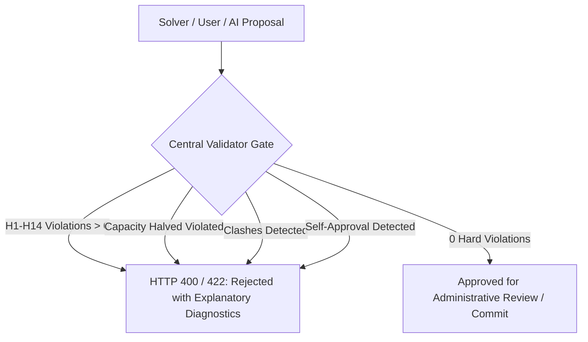

# CITRIX Phase 4: Constraint Validation Report

**Date:** October 31, 2026  
**Module:** Central Validator (`app/services/central_validator.py`)  
**Specification:** Authoritative Constraint Validation Layer for CITRIX  
**Reference Engines:** Google OR-Tools CP-SAT + Official CrunchWeek Competition Validator (`validator.py`)

---

## 1. Authoritative Validation Architecture

In CITRIX, constraint validation is strictly decoupled from solvers and AI agents:
- **Solvers propose:** CP-SAT engines search the solution space and return assignments.
- **AI agents interpret:** LLM/TinyLlama assists users in drafting requests and understanding timetable constraints.
- **Central Validator gates:** The `app/services/central_validator.py` module is the single source of truth for constraint verification. No timetable, exam schedule, booking approval, or disruption fix can be committed to the active database without passing central validation.

---

## 2. Academic Timetable Constraints (H1–H14 & S1–S6)

The academic timetable solver and validator check the full suite of official competition rules:

### 2.1 Hard Constraints (Zero-Tolerance Invariants)

| Constraint ID | Constraint Description | Mathematical / Logic Rule | Validator Check |
|---|---|---|---|
| **H1** | Room Clash Freedom | $\sum_{s \in S, \text{room}=r, \text{slot}=(d,p)} 1 \le 1$ | No physical room may hold two distinct sessions at the same period. |
| **H2** | Faculty Overlap Prevention | $\sum_{s \in S, \text{fac}=f, \text{slot}=(d,p)} 1 \le 1$ | A faculty member cannot be scheduled to teach two sessions simultaneously. |
| **H3** | Student Group Conflict-Free | $\sum_{s \in S, g \in \text{groups}(s), \text{slot}=(d,p)} 1 \le 1$ | No student cohort has overlapping mandatory classes in the same period. |
| **H4** | Room Capacity Bound | $\text{size}(s) \le \text{capacity}(\text{room}(s))$ | Classroom seating capacity must equal or exceed enrolled students. |
| **H5** | Room Type & Equipment Suitability | $\text{type}(s) \in \text{allowed\_types}(\text{room}(s))$ | Computer science labs must be held in CS-LABs; chemistry in Chem-Labs. |
| **H6** | Faculty Unavailability Windows | $\text{slot}(s) \notin \text{unavailability}(f)$ | Respects pre-declared medical, administrative, and research leaves. |
| **H7** | Room Maintenance Windows | $\text{slot}(s) \notin \text{maintenance}(r)$ | Scheduled room closures and sanitization periods are never booked. |
| **H8** | Session Duration & Continuity | $\text{periods} \text{ are contiguous}$ | Multi-period sessions (e.g., 2-period or 3-period labs) run continuously without breaks. |
| **H9** | Maximum Daily Teaching Hours | $\sum_{p=1}^{P} \text{hours}(f, d, p) \le \text{MaxDailyHours}$ | Caps faculty fatigue at institutional maximum (e.g., 4 periods/day). |
| **H10** | Institutional Lunch Break | $\text{slot}(s) \cap \text{LunchPeriod} = \emptyset$ | Teaching sessions are forbidden during designated lunch breaks (e.g., Period 5). |
| **H11** | Elective Basket Simultaneity | $\text{slot}(s_1) = \text{slot}(s_2) \;\forall s_1, s_2 \in \text{Basket}$ | Electives within the same basket run simultaneously in distinct rooms. |
| **H12** | Valid Operating Hours | $1 \le \text{start\_period} \le \text{MaxPeriod} - \text{duration} + 1$ | Sessions must fall within regular academic operating hours (Periods 1–9). |
| **H13** | Campus Boundary Feasibility | $\text{accessible}(\text{room}(s)) = \text{True}$ if student requires | Accessibility accommodation for students with mobility needs. |
| **H14** | Complete Course Allocation | $\sum_{s \in S(c)} 1 = \text{required\_sessions}(c)$ | All curricula sessions specified in syllabus must be scheduled. |

### 2.2 Soft Objectives (S1–S6 Optimization Penalties)

1. **S1 (Student Idle Gaps):** Penalizes isolated free periods between lectures for student cohorts (gap of 1 period between classes).
2. **S2 (Faculty Daily Spread):** Minimizes erratic faculty workloads across days to maintain steady teaching schedules.
3. **S3 (Early Morning Optimization):** Prioritizes complex core STEM lectures in morning slots (Periods 1–3).
4. **S4 (Room Proximity):** Minimizes consecutive travel distance between academic blocks for faculty and students.
5. **S5 (Preferred Venue Placement):** Aligns lectures with department primary buildings.
6. **S6 (Even Weekly Distribution):** Spreads recurring course sessions evenly (e.g., Mon-Wed-Fri vs Mon-Tue).

---

## 3. Midsem Examination Constraints

Validated via `validate_midsem_exam_schedule(exams_schedule, data_dict)`:

### 3.1 Halved Room Capacity Rule (Anti-Cheating Invariant)
- **Rule:** For every examination $e$ assigned to rooms $\{r_1, r_2, \dots, r_k\}$, the effective seating capacity of each room is halved:
  $$\text{EffectiveCapacity}(r) = \left\lfloor \frac{\text{capacity}(r)}{2} \right\rfloor$$
  $$\text{size}(e) \le \sum_{r \in \text{allocated\_rooms}} \text{EffectiveCapacity}(r)$$
- **Enforcement:** If a room has standard capacity 90 (e.g., `CR-101`), its effective examination capacity is 45. An exam with 50 students assigned to `CR-101` alone triggers `EXAM_CAPACITY_VIOLATION` and is rejected.

### 3.2 Student Group Overlap Prevention
- No student cohort may be assigned to two examination papers in the same examination session (AM or PM slot).
- Violations trigger `EXAM_GROUP_CLASH`.

### 3.3 Room Authorization
- Exams can only be seated in venues authorized for examination use (`"exam" in room.allowed_uses`). Booking non-exam venues triggers `EXAM_ROOM_USE_INVALID`.

---

## 4. Fest Week (Spectra Week) Priority Validation

Validated via `FestWeekEngine` and `validate_venue_booking_decision`:

### 4.1 6-Tier Priority Resolution
When multiple requests compete for the same venue at the same time, priority order is strictly deterministic:
1. **Tier 1:** Institute Events (convocations, senate meetings, foundation day).
2. **Tier 2:** Academic Core (curriculum classes, makeup lectures).
3. **Tier 3:** Department Fests (departmental academic symposiums).
4. **Tier 4:** Technical & Cultural Major (flagship fest events, keynote lectures).
5. **Tier 5:** General Club Activities (rehearsals, workshops, internal club meets).
6. **Tier 6:** External / Informal Activities.

Ties within the same tier are broken strictly by **submission timestamp (`submitted_at`)**.

### 4.2 Role Category Cap Security
Requesters cannot self-elevate their request category. A club user submitting a request categorized as `institute_event` is automatically capped to `club_event` by the backend.

### 4.3 No-Self-Approval
Any user who submits a booking request—including the Dean or Administrators—is blocked from approving their own request. Self-approval attempts return HTTP 403 Forbidden with `"No Self-Approval rule"`.

---

## 5. Disruption Rescheduling Validation

Validated via `validate_disruption_proposal`:

### 5.1 Minimal Moves Stability
- When rescheduling disrupted sessions (e.g., faculty illness `F07`), the rescheduler must preserve the existing timetable as far as possible.
- Proposals calculate exact session moves and report `time_changed`, `room_only_changed`, and total moved sessions.
- Proposals exceeding the specified `max_moves` threshold are rejected.

### 5.2 Stale Proposal Detection
- Disruption repair proposals are tied to the exact `baseline_schedule_id` active at the time of proposal computation.
- If the active timetable changes or another proposal is applied before the pending proposal is reviewed, the proposal is flagged as `superseded/stale`.
- Any attempt to apply a stale proposal is rejected with HTTP 400 Bad Request, preventing race conditions and schedule corruption.

---

## 6. Central Validator Verification Summary

| Validation Suite | Test Scenario | Expected Outcome | Actual Verification |
|---|---|---|---|
| Academic Timetable | Baseline competition schedule (`cit_public.json`) | Valid, 0 Hard Violations, Soft Total $\ge 0$ | **PASSED** (0 hard violations, soft total 3) |
| Academic Timetable | Corrupted schedule with deliberate H1 room clash | Rejected, `valid=False`, $H1 > 0$ | **PASSED** (Detected room conflict) |
| Midsem Exam | Halved capacity compliant (Size 45 in LH-3 cap 120/2=60) | Valid, `valid=True` | **PASSED** |
| Midsem Exam | Halved capacity violation (Size 50 in CR-101 cap 90/2=45) | Rejected, `EXAM_CAPACITY_VIOLATION` | **PASSED** (Rejected with count > 0) |
| Fest Week Priority | Tier 1 (Institute) vs Tier 5 (Club) Auditorium conflict | Tier 1 outranks Tier 5 | **PASSED** (`outranks == True`) |
| Approval Security | Admin attempts self-approval on own booking | Blocked with HTTP 403 | **PASSED** (`"No Self-Approval rule"`) |
| Disruption Repair | Proposal application against outdated baseline | Rejected with HTTP 400 | **PASSED** (`"Stale proposal detected"`) |
