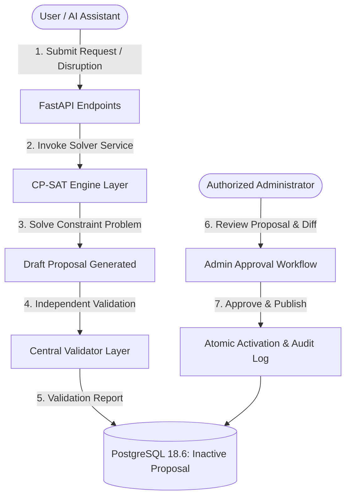

# CITRIX Phase 4: CP-SAT Engine Integration Report

**Date:** October 31, 2026  
**System:** CITRIX Campus Operations & Intelligence Platform  
**Target Environment:** FastAPI Backend + Google OR-Tools CP-SAT + Neon Serverless PostgreSQL 18.6  
**Authoritative Source:** Single Database Architecture (PostgreSQL single source of truth)

---

## 1. Executive Summary

Phase 4 of the CITRIX integration establishes an authoritative, constraint-validated execution layer connecting the Google OR-Tools CP-SAT scheduling engines with the consolidated FastAPI backend and Neon PostgreSQL database.

All scheduling operations strictly implement a **Proposal-First Architecture**:
1. **Solvers generate proposals:** CP-SAT algorithms solve optimization problems and produce non-active, proposed schedules.
2. **Central Validation:** Every proposal is subjected to the authoritative central validator (`app/services/central_validator.py`) wrapping official competition logic.
3. **Explicit Administrative Approval:** Proposed schedules cannot be applied or published automatically by background workers, regular users, or AI assistants. Only an authorized Administrator (`dean@cit.edu` / Admin role) can promote a proposal to the active published schedule.

---

## 2. Integrated Engine Architectures

### 2.1 Academic Timetable Solver (`app/services/scheduler_service.py`)
- **Engine Reference:** `CITRIX/CITRIX/engine/scheduler/solver.py` (`generate_timetable`).
- **Core Solver:** Google OR-Tools CP-SAT (`cp_model.CpModel`).
- **Input Data:** Canonical dataset loaded from database and static academic calendar metadata (`cit-public-v1`).
- **Constraints Enforced:**
  - H1-H14 Hard Constraints (Room clashes, faculty overlap, room capacity, equipment suitability, lunch break preservation, max daily hours).
  - S1-S6 Soft Optimization (Student idle gaps, faculty movement minimization, preferred morning lecture slots).
- **Service API:**
  - `generate_timetable_proposal(db, user, dataset_id, time_limit_seconds, client_ip)`
  - `publish_timetable(db, user, schedule_id, client_ip)`
- **Database Mapping:**
  - Proposals stored in `schedules` table with `is_active=False`, `status='proposal'`, and full schedule payload in `raw_schedule_json`.
  - Individual session assignments persisted in `timetable_entries`.
  - Publication atomically deactivates previous active schedules (`is_active=False`) and activates the approved schedule (`is_active=True`, `status='active'`).

### 2.2 Midsem Examination Scheduler (`app/services/exam_service.py`)
- **Engine Reference:** `CITRIX/CITRIX/engine/exams/scheduler.py` (`ExamScheduler`).
- **Critical Invariant — Halved Room Capacity Rule:**
  $$\text{Allocated Students} \le \left\lfloor \frac{\text{Room Capacity}}{2} \right\rfloor$$
  To guarantee academic integrity and anti-cheating separation during midterm examinations, examination seating strictly halves standard classroom capacities.
- **Service API:**
  - `generate_exam_schedule_proposal(db, user, time_limit_seconds, client_ip)`
  - `publish_exam_schedule(db, user, assignments, client_ip)`
- **Database Mapping:**
  - Exam session slots updated in `exams` table (`scheduled_day`, `scheduled_session`).
  - Physical room and seat allocations stored in `exam_room_allocations` table (`exam_id`, `room_id`, `allocated_seats`).

### 2.3 Spectra / Fest Week Booking Engine (`app/services/fest_service.py`)
- **Engine Reference:** `CITRIX/CITRIX/engine/fest/engine.py` (`FestWeekEngine`).
- **Multi-Tier Priority Ordering (6-Tier Hierarchy):**
  1. **Tier 1:** Institute Events (`institute_event`) — High-level institutional assemblies, convocations, official ceremonies.
  2. **Tier 2:** Academic Core (`academic_core`) — Scheduled lectures, tutorials, exam makeup sessions.
  3. **Tier 3:** Department Fests (`department_event`) — Department-specific symposiums and workshops.
  4. **Tier 4:** Technical & Cultural Major Fests (`guest_lecture` / major events) — Spectra flagship sessions.
  5. **Tier 5:** General Club Activities (`club_event`) — Coding club, dramatics society, music club.
  6. **Tier 6:** External / Informal Activities (`external_or_informal`).
- **Service API:**
  - `evaluate_campus_fest_bookings(db, user, client_ip)`
  - `decide_single_booking(db, user, booking_id, decision_in, client_ip)`
- **Approval Security & Displacements:**
  - Strictly enforces **No-Self-Approval**: Requesters are blocked from approving their own bookings (`check_booking_approval_authority`).
  - Automatic detection of displaced regular academic classes with alternative venue recommendations.

### 2.4 Disruption Rescheduler (`app/services/rescheduler_service.py`)
- **Engine Reference:** `CITRIX/CITRIX/engine/rescheduler/engine.py` (`reschedule`).
- **Minimal Disruption Objective:**
  Minimizes schedule instability when faculty report sudden unavailability or classrooms undergo emergency maintenance.
  $$\text{Minimize } \sum_{s \in S} \left( \alpha \cdot \mathbb{I}(\text{time changed}) + \beta \cdot \mathbb{I}(\text{room changed}) \right)$$
- **Service API:**
  - `generate_reschedule_proposal_for_disruption(db, user, disruption_id, time_limit_seconds, client_ip)`
  - `approve_and_apply_reschedule(db, user, disruption_id, client_ip)`
- **Safety Features:**
  - **Exact Move Diffs:** Every proposal computes an explicit list of displaced sessions (`from -> to`, `time_changed`, `room_changed`).
  - **Stale Proposal Prevention:** If the underlying active schedule changes before the proposal is approved, the system detects the divergence and rejects application with HTTP 400/409, requiring re-computation against the latest active baseline.

---

## 3. Real-Time Application Endpoints

All services are mounted under `/api/v1/` and guarded by role-based permissions:

| Route | Method | Required Permission / Role | Description |
|---|---|---|---|
| `/api/v1/schedules/generate` | `POST` | `Admin` (`schedule:generate`) | Triggers CP-SAT solver to generate academic timetable proposal. |
| `/api/v1/schedules/{id}/publish` | `POST` | `Admin` (`timetable:approve_change`) | Validates and atomically publishes timetable proposal. |
| `/api/v1/schedules/active` | `GET` | Authenticated | Retrieves current active published timetable. |
| `/api/v1/exams/generate` | `POST` | `Admin` (`exam:generate`) | Solves midsem exam schedule with halved capacity constraints. |
| `/api/v1/exams/publish` | `POST` | `Admin` (`exam:generate`) | Validates and persists exam schedule allocations. |
| `/api/v1/bookings` | `POST` | Authenticated | Submits venue booking request with role category cap. |
| `/api/v1/bookings/evaluate` | `POST` | `Admin` (`booking:approve_all`) | Executes FestWeekEngine to rank bookings across 6 priority tiers. |
| `/api/v1/bookings/{id}/decision` | `POST` | Admin / Coordinator | Approves/rejects booking with No-Self-Approval check. |
| `/api/v1/reschedule` | `POST` | Faculty / Coordinator / Admin | Registers faculty leave or room closure disruption. |
| `/api/v1/reschedule/{id}/propose` | `POST` | Faculty / Coordinator / Admin | Generates minimal-moves rescheduling proposal. |
| `/api/v1/reschedule/{id}/approve` | `POST` | `Admin` (`timetable:approve_change`) | Stale-checked, No-Self-Approval verified application of proposal. |

---

## 4. Verification and Concurrency Integrity

- **Database Concurrency:** All schedule activations utilize PostgreSQL transactions. Deactivation of old schedules and activation of new schedules occur in the same transaction block.
- **Audit Logging:** Every proposal generation, publication, booking decision, and disruption application writes an immutable record to the `audit_logs` table with actor identity, action name, IP address, and JSON diff payload.
