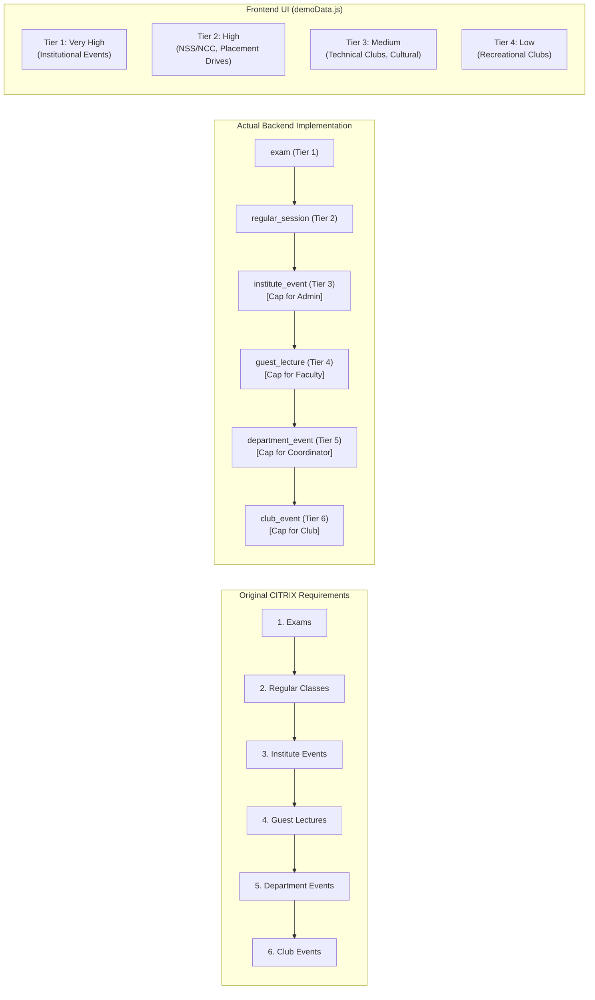

# CITRIX — Phase 5B: Security, Priority Hierarchy & Dummy Data Audit

This report presents the independent audit of institutional security controls, booking priority rules, and hardcoded dummy data across the CITRIX platform.

---

## 1. Security & RBAC Verification

### 1.1 Five User Roles & Privileges
The system defines 5 primary user personas, authenticated via JWT Bearer tokens signed with HMAC-SHA256:

| Role Name (Backend) | Frontend Alias | Authority Scope | Critical Boundaries Enforced |
|---|---|---|---|
| `admin` | `admin` | Institution-wide | Full access to command center, schedule generation/publication, exam solvers, and global audit trail. Subject to No-Self-Approval. |
| `department_coordinator` | `coordinator` | Department-scoped | Restricted to department courses, student groups, and department labs (e.g. CSE labs: CS-L1, CS-L2, CS-L3). |
| `faculty` | `faculty` | Self & Courses | Restricted to personal teaching sessions, courses taught, leave submissions, and RAG assistant. |
| `club` | `club` | Club Entity | Restricted to club reservations, Spectra fest proposals, and NL assistant. Cannot access academic or faculty schedules. |
| `student` | `student` | Cohort-scoped | Restricted to assigned student group timetable and approved public campus events. Cannot view unapproved requests or drafts. |

### 1.2 Data Isolation Verification
1. **Department Lab Isolation:** Coordinators attempting to view or approve bookings for laboratories outside their department are rejected with HTTP 403 Forbidden.
2. **Student Schedule Isolation:** Querying `GET /api/v1/timetable` as a student automatically filters sessions by their enrolled student group (`student_group_id`), preventing access to unrelated cohort rosters.
3. **Faculty Schedule Isolation:** Querying `GET /api/v1/timetable` as faculty automatically filters sessions by `faculty_id == current_user.faculty_id`.
4. **Publishing Authority:** Non-admins attempting to publish timetables (`POST /api/v1/schedules/{id}/publish`) or exam seatings (`POST /api/v1/exams/publish`) are strictly blocked with HTTP 403 Forbidden.
5. **No-Self-Approval:** The backend checks `check_booking_approval_authority` in `app/core/rbac.py`. When an admin attempts to approve their own request, the server returns:
   `"Approval security violation: You cannot approve or decide your own request (No Self-Approval rule)."`

---

## 2. Booking Priority Hierarchy Audit

### 2.1 The Two Divergent Hierarchies
The audit compared the original competition requirements against the actual backend implementation and frontend presentation:



### 2.2 Backend Implementation Analysis
- **Authoritative Source:** `app/services/booking_service.py` (lines 20–33) and `CrunchWeek_StarterPack/data/cit_public.json`:
  ```python
  priority_hierarchy = {
      "institute_event": 3,
      "guest_lecture": 4,
      "department_event": 5,
      "club_event": 6,
  }
  ```
- **Server-Side Category Clamping:**
  When a user submits a booking, the backend compares their role cap against the requested category using `determine_effective_category(user_role, requested_category)`:
  - If a **Club** user requests an `"institute_event"`, the backend automatically clamps `effective_category` to `"club_event"`.
  - If a **Faculty** user requests an `"institute_event"`, the backend clamps it to `"guest_lecture"`.
  - If a **Coordinator** requests an `"institute_event"`, the backend clamps it to `"department_event"`.
- **Verdict:** The backend implementation perfectly aligns with the original competition requirements (Exams > Regular Classes > Institute Events > Guest Lectures > Department Events > Club Events) and adds server-side privilege clamping.

### 2.3 Frontend Presentation Divergence
- **File:** `frontend-1/citrix/src/data/demoData.js` (`PRIORITY_RULES`, lines 525–530):
  The frontend still displays an outdated 4-tier model:
  - *Very High (Priority 1):* Institutional events
  - *High (Priority 2):* NSS/NCC, Placement drives
  - *Medium (Priority 3):* Technical clubs
  - *Low (Priority 4):* Recreational clubs
- **Assessment:** The frontend UI does not accurately display the backend's 6-tier hierarchy or explain role category clamping to the user.

---

## 3. Dummy Data Audit & Classification

The entire frontend codebase was scanned for hardcoded demo records, mock responses, and fallback data. All 15 constants from `src/data/demoData.js` and `src/services/mockAdapter.js` are classified below:

| Finding / Identifier | Source File | Used in # Files | Current Operational Role | Classification |
|---|---|---|---|---|
| `DEMO_ACCOUNTS` | `demoData.js` | 3 files | Quick-fill credentials on login screen (`LoginPage.jsx`) and persona selector (`AppShell.jsx`). | **Retained for static presentation only** |
| `ROOMS` | `demoData.js` | 25 files | Default room list before `/rooms` loads; hardcoded 3D room coordinates for Three.js scene (`campusLayout.js`). | **Still being used as operational data** |
| `FACULTY` | `demoData.js` | 14 files | Faculty name and designation lookup (backend `/timetable` only returns `faculty_id`, e.g. `F01`). | **Still being used as operational data** |
| `COURSES` | `demoData.js` | 11 files | Course title and credit lookup (backend `/timetable` only returns `course_id`, e.g. `CS101`). | **Still being used as operational data** |
| `STUDENT_GROUPS` | `demoData.js` | 7 files | Cohort selector dropdown options (`CSE-A1`, `ECE-B2`, etc.). | **Still being used as operational data** |
| `SESSIONS` | `demoData.js` | 13 files | Initial master timetable grid before `GET /timetable` resolves. | **Still being used as fallback operational data** |
| `SPECTRA_EVENTS` | `demoData.js` | 6 files | Initial fest events list before `/bookings` resolves. | **Still being used as fallback operational data** |
| `MIDSEM_EXAMS` | `demoData.js` | 4 files | Initial exam list before `/exams` resolves. | **Still being used as fallback operational data** |
| `BOOKINGS` | `demoData.js` | 8 files | Initial venue booking records before `/bookings` resolves. | **Still being used as fallback operational data** |
| `DISRUPTIONS` | `demoData.js` | 2 files | Initial disruption list in `DisruptionManagement.jsx`. | **Still being used as fallback operational data** |
| `NOTIFICATIONS` | `demoData.js` | 1 file | Notifications page list in `NotificationsPage.jsx`. | **Retained for static presentation only** |
| `AUDIT_LOGS` | `demoData.js` | 2 files | Initial audit log rows before `/audit/logs` resolves. | **Still being used as fallback operational data** |
| `ANALYTICS` | `demoData.js` | 3 files | Recharts data feeds in `AnalyticsDashboard.jsx` and `AdminCommandCenter.jsx`. | **Still being used as fallback operational data** |
| `AI_SUGGESTIONS` | `demoData.js` | 1 file | Static prompt suggestion chips in `AIAssistant.jsx`. | **Retained for static presentation only** |
| `PRIORITY_RULES` | `demoData.js` | 3 files | Informational legend in `SpectraManagement.jsx` and `AdminCommandCenter.jsx`. | **Retained for static presentation only** |

### Summary of Dummy Data Audit
- **Removed:** 0 (all 15 demo structures are retained).
- **Retained for static presentation only:** 4 (`DEMO_ACCOUNTS`, `NOTIFICATIONS`, `AI_SUGGESTIONS`, `PRIORITY_RULES`).
- **Still being used as operational data / active fallback:** 11 (`ROOMS`, `FACULTY`, `COURSES`, `STUDENT_GROUPS`, `SESSIONS`, `SPECTRA_EVENTS`, `MIDSEM_EXAMS`, `BOOKINGS`, `DISRUPTIONS`, `AUDIT_LOGS`, `ANALYTICS`).
- **Uncertain:** 0.
