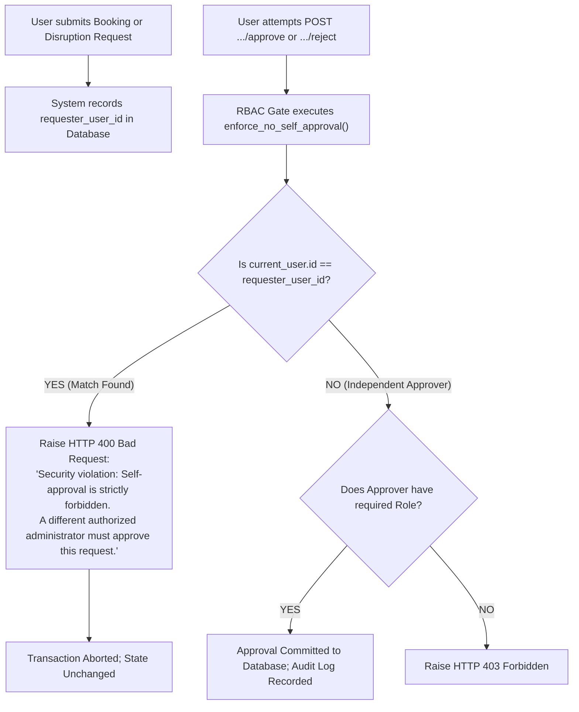

# CITRIX — Role-Based Access Control (RBAC) & Permission Matrix

**Document Version:** 1.0.0  
**Status:** Approved Architectural Blueprint (Pre-Implementation)  
**Security Standard:** Strict Principle of Least Privilege, Data Scoping & Anti-Self-Approval

---

## 1. Persona & Role Classification

CITRIX implements a granular Role-Based Access Control (RBAC) model mapping directly to the official competition roles, with scoped extensions for campus students and security staff.

| Unified System Role | Official Competition Persona | Architectural Scope & Responsibility |
| :--- | :--- | :--- |
| **`ADMIN`** | **Dean's Office / Administration** | Global campus-wide administrative authority. Sole authority to approve timetable generation, activate minimal-change disruption schedules, and review Dean's operational intelligence. Booking cap: `institute_event`. |
| **`COORDINATOR`** | **Department Coordinator** | Scoped to academic department (e.g. CSE, ECE, ME). Authority over departmental student groups, course offerings, and approval authority over departmental specialized laboratories. Booking cap: `department_event`. |
| **`FACULTY`** | **Faculty Member** | Scoped to assigned faculty identity (e.g. F01–F40). Views assigned teaching sessions, marks personal leave/unavailability blocks, and requests guest lecture bookings. Booking cap: `guest_lecture`. |
| **`CLUB`** | **Club Representative** | Represents recognized campus student organizations (e.g. Robotics Club, Coding Club, Cultural Society). Requests event venues during regular weeks and Spectra Fest Week. Booking cap: `club_event`. |
| **`STUDENT`** | **Enrolled Student (Cohort Scoped)** | Scoped strictly to assigned student cohort (e.g. Y1-A, CSE-2, ECE-3). Read-only visibility over their group's class schedule, exam dates, and public campus notices. No approval or modification privileges. |
| **`SECURITY`** | **Campus Security & Premises** | Scoped to physical campus security desks and gate operations. Read-only visibility over room occupancy status, scheduled evening events (P10–P13), and visitor booking rosters. |

---

## 2. Granular Permission Matrix

| Operational Capability | Description / Endpoint | `ADMIN` | `COORDINATOR` | `FACULTY` | `CLUB` | `STUDENT` | `SECURITY` |
| :--- | :--- | :---: | :---: | :---: | :---: | :---: | :---: |
| **1. Viewing Timetables** | Global or scoped class schedule retrieval | **Global (All)** | **Dept Scoped** | **Own Scoped** | **Public** | **Group Scoped** | **Room Scoped** |
| **2. Requesting Schedule Changes** | Submitting disruption request (leave / closure) | **Yes** | **Dept Scoped** | **Own Scoped** | No | No | No |
| **3. Marking Faculty Unavailability** | Declaring unavailable periods on academic calendar | **Yes** | **Dept Scoped** | **Own Scoped** | No | No | No |
| **4. Creating Venue Bookings** | Reserving lecture halls, auditoriums, classrooms | **Yes** (Cap 5) | **Yes** (Cap 3) | **Yes** (Cap 4) | **Yes** (Cap 2) | No | No |
| **5. Approving / Rejecting Bookings** | Formal approval or rejection of venue requests | **Yes (All Venues)**| **Dept Labs Only**| No | No | No | No |
| **6. Suggesting Alternatives** | Proposing alternative venue or time window | **Yes** | **Dept Labs Only**| No | No | No | No |
| **7. Generating Timetables** | Triggering Google OR-Tools CP-SAT solver | **Yes** | No | No | No | No | No |
| **8. Approving Timetable Changes** | Activating regenerated or repaired schedule | **Yes** | No | No | No | No | No |
| **9. Changing Booking Priorities** | Overriding default category weights or caps | **Yes** | No | No | No | No | No |
| **10. Operational Intelligence** | Dean's real-time briefing & bottleneck alerts | **Yes** | **Dept Scoped** | No | No | No | **Premises Only** |

> **Note on Student & Security Roles:**  
> Neither `STUDENT` nor `SECURITY` is granted booking approval, disruption approval, or timetable generation capabilities. Granting operational approval privileges to students or premises security staff would violate institutional governance constraints and invalidate competition requirements.

---

## 3. Strict Anti-Self-Approval Enforcement

Under the competition's security integrity mandates, **no administrator, department head, or coordinator may approve an operational request that they personally submitted.**



### Code Implementation (`app/core/rbac.py`):
```python
def enforce_no_self_approval(requester_id: Optional[str], approver_id: str) -> None:
    """
    Prevents self-approval loops across all operational workflows.
    Even administrators with superuser permissions cannot approve their own submissions.
    """
    if requester_id and str(requester_id).strip() == str(approver_id).strip():
        raise HTTPException(
            status_code=status.HTTP_400_BAD_REQUEST,
            detail="Security violation: Self-approval is strictly forbidden. A different authorized administrator must review and approve this request.",
        )
```

---

## 4. Role Data Isolation & Scoping Specification

Every database query executed through application services or the AI tool registry applies mandatory role-based scoping filters:

### 1. Timetable Data Isolation (`app/services/timetable_service.py`)
- **`STUDENT`:** Queries are strictly clamped to `user.student_group_id` (e.g. `Y1-A`, `CSE-2`). Students cannot inspect schedules of other cohorts.
- **`FACULTY`:** Queries are strictly clamped to `user.faculty_id` (e.g. `F01`). Faculty cannot query personal teaching timetables of colleagues unless granted administrative permission.
- **`COORDINATOR`:** Queries are filtered to courses and student groups belonging to `user.department` (e.g. `CSE`).
- **`ADMIN`:** Unrestricted global visibility across all 14 student groups, 40 faculty members, and 27 rooms.

### 2. Examination Isolation (`app/services/exam_service.py`)
- **`STUDENT`:** Can only view midterm exams associated with courses enrolled by their student group.
- **`FACULTY`:** Can view exams for courses they teach or invigilate.
- **`ADMIN`:** Full view of the 6-day midterm examination matrix and alternate-seating room allocations.

### 3. Venue Booking Isolation (`app/services/booking_service.py`)
- **`CLUB` & `FACULTY`:** `GET /api/v1/bookings` returns only bookings where `requester_user_id == current_user.id` or `requester == current_user.club_name`.
- **`COORDINATOR`:** Can view all bookings requested by members of their department and bookings requesting departmental lab venues.
- **`ADMIN`:** Can view and filter all campus bookings across all 4 categories.

---

## 5. Booking Category Caps by Role (`role_category_cap`)

Booking requests during regular terms and Spectra Fest Week are subject to strict category capping derived from the canonical dataset (`CrunchWeek_StarterPack/data/cit_public.json`):

| Requester Role | Maximum Permitted Category (`role_category_cap`) | Priority Weight (`CAT_WEIGHT`) | Permitted Venues |
| :--- | :--- | :---: | :--- |
| **`ADMIN`** | `institute_event` | **5** (Highest) | All venues (Auditorium, Seminar Halls, Lecture Halls, Classrooms, Grounds) |
| **`FACULTY`** | `guest_lecture` | **4** | Seminar Halls, Lecture Halls, Classrooms |
| **`COORDINATOR`**| `department_event` | **3** | Department Laboratories, Department Classrooms, Seminar Halls |
| **`CLUB`** | `club_event` | **2** | Classrooms, Outdoor Grounds, Student Activity Center (No Seminar Halls) |

> **Enforcement Rule:** If a club representative submits a request marking `requested_category = "institute_event"`, the backend automatically clamps `effective_category = "club_event"`. A club request cannot displace an academic session or a department event.
