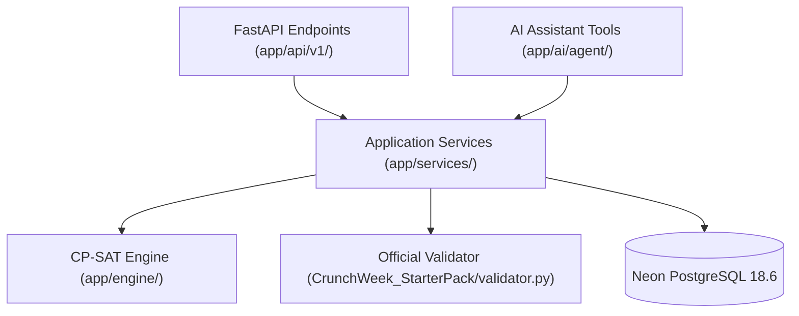

# CITRIX — Service Interface & Contract Specification

**Document Version:** 1.0.0  
**Status:** Approved Architectural Blueprint (Pre-Implementation)  
**Target:** Application Service Layer (`app/services/`) & Intelligence Core (`app/engine/`)

---

## 1. Overview & Clean Architectural Boundaries

To prevent duplication of business logic between the FastAPI REST API, the AI Assistant tool execution, and the deterministic optimization solvers, CITRIX defines strictly typed service contracts.



---

## 2. Core Service Interface Specifications

### 2.1 Interface 1: Timetable Generation Service
- **Responsible Module:** `app/engine/scheduler/solver.py` via `app/services/timetable_service.py`
- **Method Signature:**
  ```python
  def generate_timetable(
      dataset_or_source: Dataset | str | Path | dict,
      options: Optional[SolverOptions] = None,
  ) -> TimetableResult:
  ```
- **Input Schema:**
  ```python
  @dataclass
  class SolverOptions:
      time_limit_seconds: float = 30.0
      num_workers: int = 8
      optimize_soft: bool = True
      soft_weights: Optional[Dict[str, int]] = None
      random_seed: int = 42
      log_search_progress: bool = False
  ```
- **Output Schema:**
  ```python
  @dataclass
  class TimetableResult:
      status: str  # OPTIMAL | FEASIBLE | INFEASIBLE | UNKNOWN
      is_feasible: bool
      objective_value: Optional[float]
      wall_time_seconds: float
      sessions: List[Dict[str, Any]]  # [{"session_id": "...", "day": "MON", "start_period": 1, "room_id": "CR-101"}]
      schedule_dict: Dict[str, Any]   # Canonical validator payload
      diagnostics: Dict[str, Any]
  ```
- **Database Interactions:**
  - *Reads:* Queries `sessions`, `session_groups`, `faculty_profiles`, `faculty_unavailabilities`, `rooms`, `room_unavailabilities`, `academic_periods`.
  - *Writes:* None directly during solver run (pure functional execution).
- **Validation Requirements:** Must execute all H1–H14 constraints in CP-SAT and pass `validator.py` with 0 hard violations before staging.
- **Error Handling:** If solver exceeds `time_limit_seconds` without finding a feasible placement, returns `is_feasible = False`, `status = "INFEASIBLE"`, raising `HTTPException(422, "Timetable generation timed out without feasible solution")`.

---

### 2.2 Interface 2: Examination Scheduling Service
- **Responsible Module:** `app/engine/exams/engine.py` via `app/services/exam_service.py`
- **Method Signature:**
  ```python
  def generate_exam_schedule(
      dataset: Dataset,
      time_limit_seconds: float = 15.0,
  ) -> ExamScheduleResult:
  ```
- **Input Schema:**
  - `dataset`: Parsed Pydantic `Dataset` containing `exams`, `rooms`, and `calendar.exam_week`.
  - `time_limit_seconds`: Maximum solver runtime (default: 15.0s).
- **Output Schema:**
  ```python
  @dataclass
  class ExamScheduleResult:
      status: str
      is_feasible: bool
      soft_penalty: int
      wall_time_seconds: float
      assignments: List[Dict[str, Any]]
      # [{ "exam_id": "EX-MA101", "day": "MON", "session": "AM", "allocations": [{"room_id": "AUD", "seats": 150}] }]
  ```
- **Database Interactions:**
  - *Reads:* Queries `exams`, `courses`, `student_groups`, `rooms` (filtering `allowed_uses` containing `"exam"`).
  - *Writes:* Staged in transaction to `exams` and `exam_room_allocations`.
- **Validation Requirements:** Alternate-seating rule strictly enforced: $\text{seats}(room) \le \text{capacity} // 2$. No student group may have $> 1$ exam in the same AM/PM slot.
- **Error Handling:** Returns `status = "INFEASIBLE"` if total enrolled examinees exceed aggregate half-capacity across exam-approved venues.

---

### 2.3 Interface 3: Spectra Fest Booking Evaluation Service
- **Responsible Module:** `app/engine/fest/engine.py` via `app/services/booking_service.py`
- **Method Signature:**
  ```python
  def evaluate_fest_week(
      raw_dataset: dict,
      timetable_sessions: List[dict],
  ) -> FestScheduleResult:
  ```
- **Input Schema:**
  - `raw_dataset`: Raw dictionary of `cit_public.json` including `booking_requests`, `cancellations`, and `role_category_cap`.
  - `timetable_sessions`: Active timetable assignments to detect class displacement.
- **Output Schema:**
  ```python
  @dataclass
  class FestScheduleResult:
      approved_count: int
      rejected_count: int
      alternative_count: int
      decisions: List[Dict[str, Any]]
      # [{ "booking_id": "BR-01", "status": "approved", "room_id": "SH-1", "day": "THU", "start_period": 10, "end_period": 12, "reason": None }]
      overridden_sessions: List[str]  # Regular sessions displaced by institute events
  ```
- **Database Interactions:**
  - *Reads:* `booking_requests`, `event_categories`, `roles`, `rooms`, `timetable_entries`.
  - *Writes:* Batch updates `booking_requests` (`status`, `assigned_room_id`, `decision_reason`) and marks `timetable_entries.is_overridden_for_fest = TRUE`.
- **Validation Requirements:** Clamps requested category by `role_category_cap`; verifies zero priority inversions (`validator.py` check).

---

### 2.4 Interface 4: Disruption & Minimal-Change Rescheduling Service
- **Responsible Module:** `app/engine/rescheduler/engine.py` via `app/services/disruption_service.py`
- **Method Signature:**
  ```python
  def reschedule(
      baseline_schedule: dict,
      disruption: dict,
      raw_dataset: dict,
      time_limit_seconds: float = 30.0,
  ) -> RescheduleResult:
  ```
- **Input Schema:**
  - `baseline_schedule`: Currently active schedule dictionary.
  - `disruption`: Disruption payload: `{"changes": [{"type": "room_unavailable", "room_id": "LH-4", "days": ["MON", "TUE"], "periods": [1,2,3]}]}`.
  - `raw_dataset`: Canonical dataset dictionary.
- **Output Schema:**
  ```python
  @dataclass
  class RescheduleResult:
      status: str
      is_feasible: bool
      sessions_moved: int
      time_changed: int
      room_only_changed: int
      wall_time_seconds: float
      schedule_dict: Dict[str, Any]
      diagnostics: Dict[str, Any]
  ```
- **Database Interactions:**
  - *Reads:* Reads `schedules` (is_baseline=TRUE), `timetable_entries`, and `disruptions` (status='pending').
  - *Writes:* Creates a new `schedule_versions` row, updates displaced `timetable_entries`, and updates `disruptions.status = 'approved'`.
- **Validation Requirements:** Minimizes moved sessions ($\sum \mathbb{I}(\text{session displaced})$) while guaranteeing 0 hard violations on the repaired schedule.

---

### 2.5 Interface 5: Official Validator Adapter Service
- **Responsible Module:** `app/engine/scheduler/validator_adapter.py` via `app/services/validator_service.py`
- **Method Signature:**
  ```python
  def run_official_validator(
      schedule_dict: dict,
      dataset_dict: Optional[dict] = None,
      baseline_dict: Optional[dict] = None,
      disruption_dict: Optional[dict] = None,
  ) -> Dict[str, Any]:
  ```
- **Output Schema:**
  ```python
  {
      "success": True,
      "report": {
          "hard_violations_count": 0,
          "hard_violations": [],
          "hard_by_rule": {},
          "soft_penalties": {"S1_faculty_pref": 12, "S2_student_gaps": 45, "total": 92},
          "warnings": []
      }
  }
  ```
- **Database Interactions:** Pure read-only validation check.
- **Validation Requirements:** Executes `CrunchWeek_StarterPack/validator.py` without code modification.

---

### 2.6 Interface 6: Timetable Persistence Service
- **Responsible Module:** `app/services/timetable_service.py`
- **Method Signature:**
  ```python
  def commit_schedule(
      db: Session,
      user: CurrentUser,
      timetable_result: TimetableResult,
      is_baseline: bool = False,
  ) -> Schedule:
  ```
- **Database Transaction Flow:**
  ```sql
  BEGIN;
  -- 1. Deactivate existing active schedules
  UPDATE schedules SET is_active = FALSE WHERE is_active = TRUE;
  -- 2. Insert new schedule master record
  INSERT INTO schedules (id, name, dataset_id, is_active, status, hard_violations_count, soft_penalty_total, raw_schedule_json)
  VALUES (...);
  -- 3. Bulk insert/upsert 189 placement entries
  INSERT INTO timetable_entries (schedule_id, session_id, day, start_period, end_period, room_id)
  VALUES (...);
  -- 4. Record audit trail
  INSERT INTO audit_logs (user_id, action, entity_type, entity_id, status)
  VALUES (...);
  COMMIT;
  ```

---

### 2.7 Interface 7: Venue Booking Approval Service
- **Responsible Module:** `app/services/booking_service.py`
- **Method Signatures:**
  ```python
  def approve_booking(db: Session, user: CurrentUser, booking_id: str) -> BookingRequest:
  def reject_booking(db: Session, user: CurrentUser, booking_id: str, reason: str) -> BookingRequest:
  def offer_alternative(db: Session, user: CurrentUser, booking_id: str, alt_room_id: str, alt_day: str, alt_start: int, alt_end: int, reason: str) -> BookingRequest:
  ```
- **Validation Checks:**
  1. `enforce_no_self_approval(booking.requester_user_id, user.id)`
  2. Role clearance check: `COORDINATOR` can only approve bookings for rooms located in their department and typed as departmental laboratories (`lab_cs`, `lab_elec`, etc.).
  3. Non-empty `reason` required for rejections and alternatives.

---

### 2.8 Interface 8: Room Availability Service
- **Responsible Module:** `app/services/campus_service.py`
- **Method Signature:**
  ```python
  def get_room_availability(
      db: Session,
      room_id: str,
      day: str,
      period: Optional[int] = None,
  ) -> Dict[str, Any]:
  ```
- **Output Schema:** Returns room metadata, list of `free_periods` ($[1\dots 13]$), and `occupied_periods` mapping each busy period to the holding session, approved booking, or maintenance exclusion.

---

### 2.9 Interface 9: AI Tool Execution Gateway
- **Responsible Module:** `app/ai/agent/tools.py`
- **Method Signature:**
  ```python
  def execute_tool(
      name: str,
      db: Session,
      user: CurrentUser,
      **kwargs,
  ) -> Dict[str, Any]:
  ```
- **Security Check:**
  - Validates `user.role` against tool's `required_role`.
  - Blocks any attempt by an AI tool to directly mutate database state; state-modifying actions return a confirmation payload with an ephemeral HMAC token for `/api/v1/assistant/confirm-action`.
