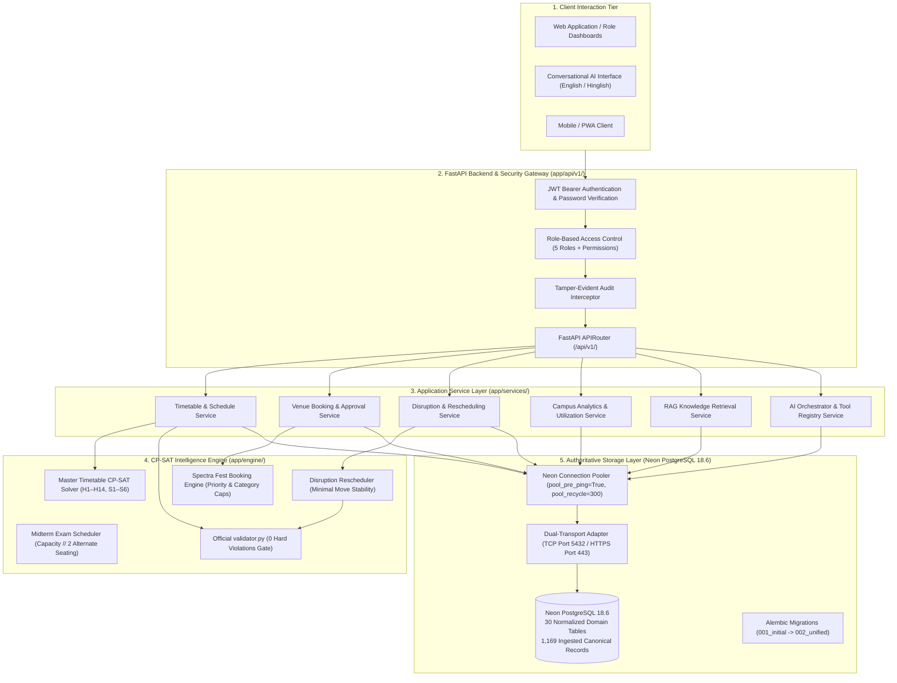
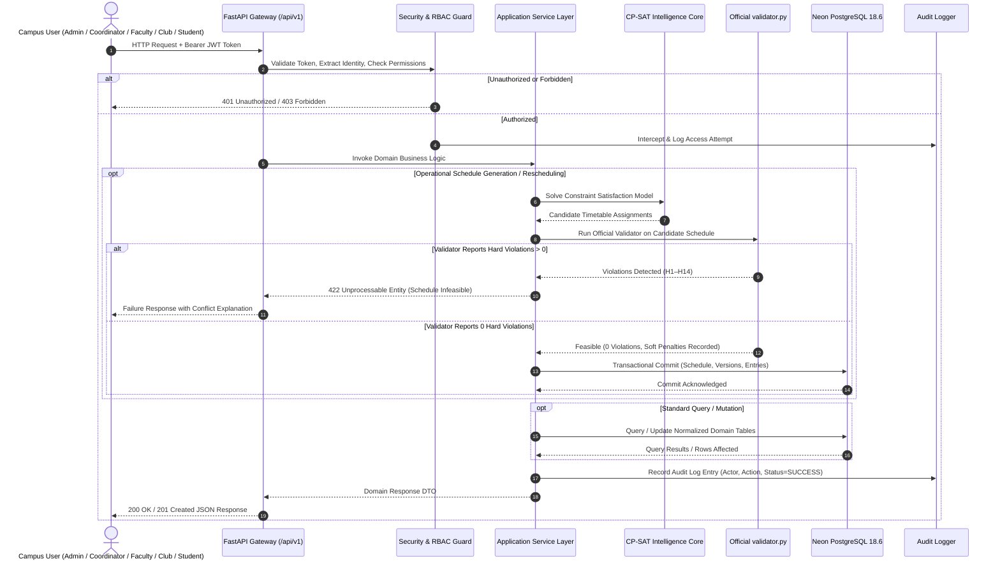
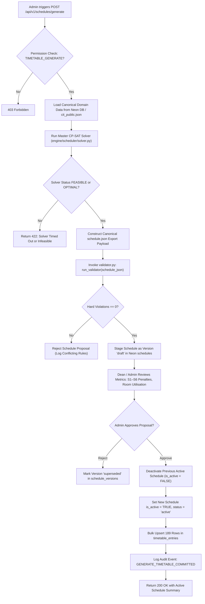
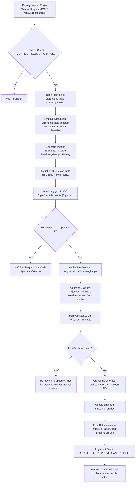
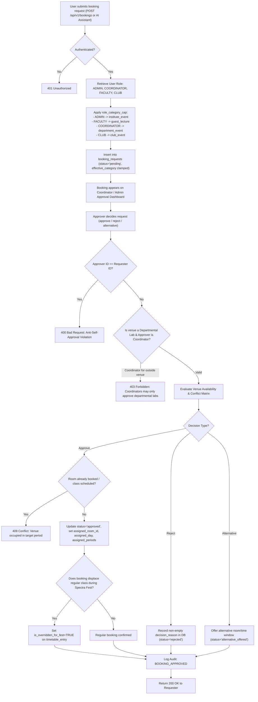
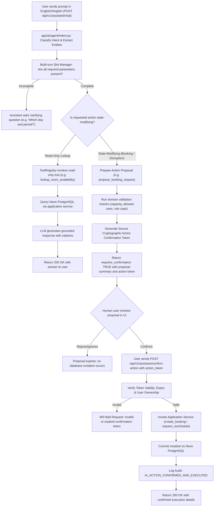

# CITRIX — Unified System Architecture Specification

**Document Version:** 1.0.0  
**Status:** Approved Architecture Blueprint (Pre-Implementation)  
**Target Systems:** Chilika Institute of Technology (CIT) Operations Platform  
**Primary Authoritative References:** `CITRIX_INTEGRATION_AUDIT.md`, `CITRIX_INTEGRATION_FILE_MAP.md`

---

## 1. Executive System Overview

CITRIX is an intelligent, constraint-governed campus operations platform designed to orchestrate academic schedules, venue reservations, emergency disruptions, and institutional knowledge for Chilika Institute of Technology (CIT).

### Core Architectural Decisions & Invariants
1. **Single Source of Truth:** Hosted **Neon Serverless PostgreSQL 18.6** is the sole persistent database. The local SQLite database (`campus_ops.db`) will be systematically retired.
2. **Authoritative Optimization Core:** The standalone **Google OR-Tools CP-SAT** solver (`engine/`) is the sole engine for generating timetables, scheduling midterm examinations, deciding Spectra Week bookings, and computing minimal-displacement disruption repairs.
3. **Deterministic Ground Truth:** The official competition validator (`CrunchWeek_StarterPack/validator.py`) is the invariant judge of schedule feasibility. No generated or repaired timetable may be persisted as `active` without achieving **0 hard constraint violations**.
4. **Agentic AI Operational Boundary:** The LLM agent (`TinyLlama/TinyLlama-1.1B-Chat-v1.0` via `langchain_huggingface`) understands and communicates in English and Hinglish, but cannot execute state modifications directly. State-altering proposals require human-in-the-loop cryptographic confirmation tokens before execution.
5. **Zero Self-Approval:** No campus actor (including Dean's Office administrators or Department Coordinators) can approve their own venue bookings or schedule disruption requests.

---

## 2. High-Level Architecture Diagram



---

## 3. Detailed Request-Flow Diagram



---

## 4. Timetable Generation & Admin Approval Flow



---

## 5. Disruption & Rescheduling Flow



---

## 6. Spectra Week Venue Booking Submission & Approval Flow



---

## 7. AI Tool-Calling & Human Confirmation Flow



---

## 8. Cross-Cutting Architectural Layers

### 8.1 Dual-Transport Database Resilience
To eliminate local corporate/academic firewall resets on raw TCP port 5432 (`WinError 10054`), CITRIX uses a dual-transport query architecture:
- **Primary TCP Transport:** Standard connection pool using `psycopg2-binary` (`pool_pre_ping=True`, `pool_recycle=300`, `pool_size=5`, `max_overflow=10`).
- **Secondary HTTPS Transport (TLS 443):** Fallback queries over Neon Cloud REST SQL (`https://<neon-host>/sql`).
- All services interact through `get_db()` or standard SQLAlchemy repositories, isolating business logic from transport failover.

### 8.2 RAG Knowledge Base Architecture
- **Corpus Ingestion:** Institutional scheduling policies (P1–P9, lunch intervals, 3-hour lab rules), Spectra Fest guidelines, room catalogs, and exam guidelines are stored in Neon's `knowledge_documents` and `document_chunks` tables.
- **Hybrid Retrieval:** BM25 keyword matching combined with dense cosine similarity scoring ensures exact match on room numbers (`CR-101`, `SH-1`) and semantic matches on queries like *"rules for booking auditorium during fest"*.
- **Role-Based Document Filtering:** Documents have `access_role_minimum` attributes (e.g. `student`, `faculty`, `coordinator`, `admin`). Queries submitted by students strictly filter out internal Dean's administrative memos.
- **Source Citation:** Every generated policy answer returns explicit markdown citations (document title, section, page, and snippet).

### 8.3 Anti-Self-Approval Enforcement
In compliance with competition security mandates:
```python
def enforce_no_self_approval(requester_id: Optional[str], approver_id: str) -> None:
    if requester_id and requester_id == approver_id:
        raise HTTPException(
            status_code=status.HTTP_400_BAD_REQUEST,
            detail="Security violation: Self-approval is strictly forbidden. A different authorized administrator must approve this request."
        )
```
This check is applied across venue booking approvals (`POST /api/v1/bookings/{id}/approve`) and schedule disruption approvals (`POST /api/v1/reschedule/{id}/approve`).

---

## 9. Verification & Architectural Invariant Checklist

| Architectural Invariant | Enforcement Mechanism | Verification Evidence |
| :--- | :--- | :--- |
| **Neon PostgreSQL as sole database** | `app/core/config.py` and `app/core/database.py` configured exclusively for PostgreSQL. | SQLite dependencies removed; 30 domain tables verified on Neon. |
| **0 Hard Constraint Violations** | Every timetable generation and rescheduling invocation executes `validator.py`. | 0 hard violations verified in `exports/schedule.json` across 189 sessions. |
| **No Unconfirmed AI State Changes** | State-modifying tools output `requires_confirmation: True` and require `/confirm-action`. | Automated in `app/ai/agent/tools.py` and tested in `test_agent_scenarios.py`. |
| **Anti-Self-Approval** | Rejection if `requester_id == approver_id`. | Tested in `tests/test_approval_security.py`. |
| **Alternate Exam Seating** | Room exam capacity strictly clamped to `capacity // 2`. | Enforced in `engine/exams/engine.py` and `test_exam_scheduler.py`. |
| **Auditing of All Critical Actions** | Synchronous commit to `audit_logs` table before API return. | Tested in `tests/test_audit_log.py`. |
