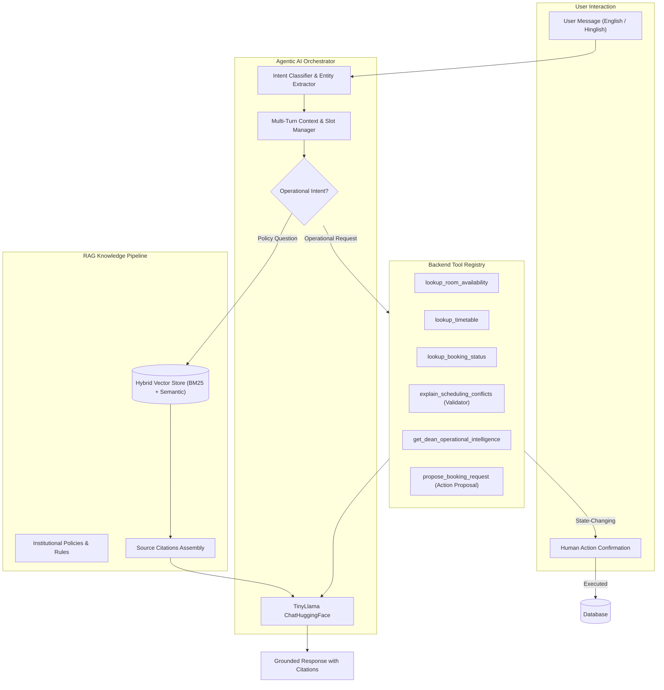
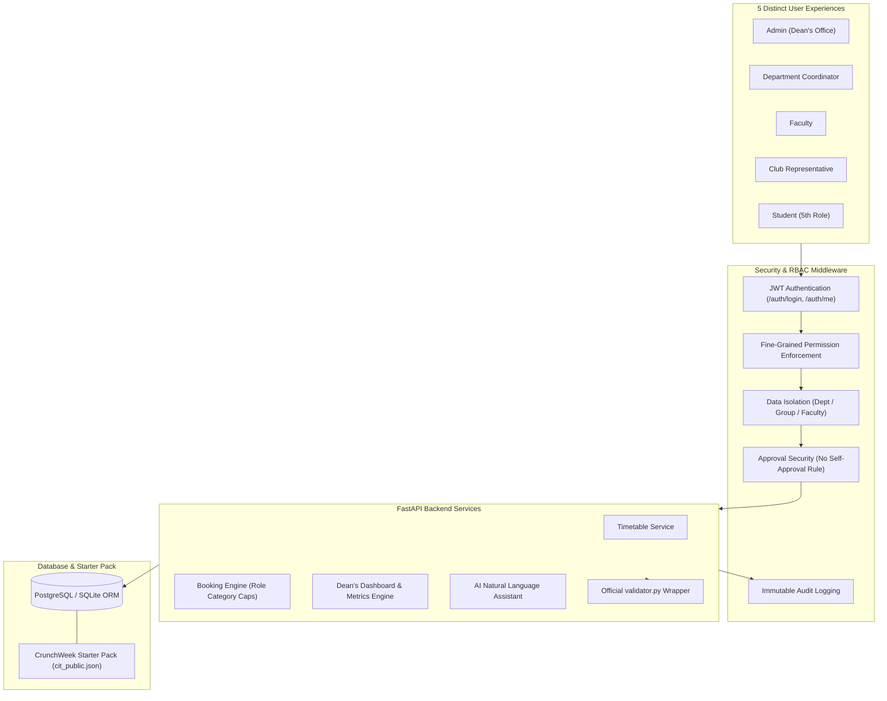
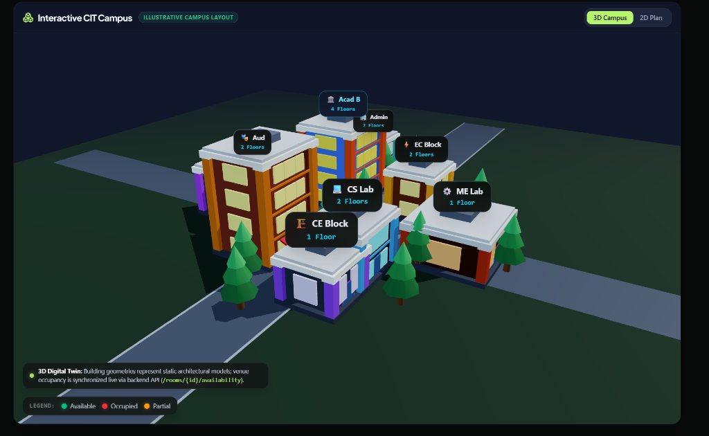
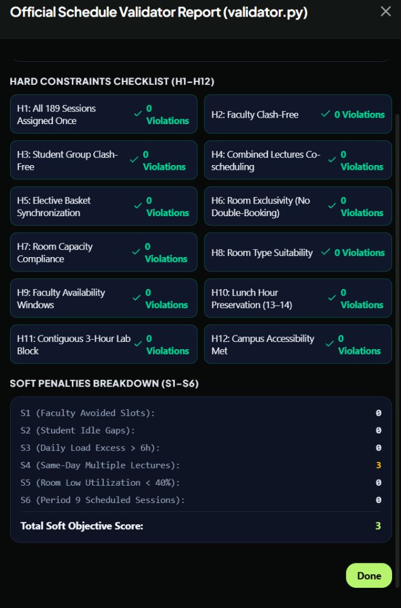

# CITRIX — Intelligent Campus Management & Operations Platform

<div align="center">

```text
 ██████╗██╗████████╗██████╗ ██╗██╗  ██╗
██╔════╝██║╚══██╔══╝██╔══██╗██║╚██╗██╔╝
██║     ██║   ██║   ██████╔╝██║ ╚███╔╝
██║     ██║   ██║   ██╔══██╗██║ ██╔██╗
╚██████╗██║   ██║   ██║  ██║██║██╔╝ ██╗
 ╚═════╝╚═╝   ╚═╝   ╚═╝  ╚═╝╚═╝╚═╝  ╚═╝
```


**One Campus. One System.**

An intelligent campus operations platform engineered for **Chilika Institute of Technology (CIT)**.

[](https://www.python.org/)
[](https://fastapi.tiangolo.com/)
[](https://www.postgresql.org/)
[](https://www.sqlalchemy.org/)
[](https://docs.pydantic.dev/)
[](https://pytest.org/)

**Built by Team Delta X**

</div>

---

## Overview

**CITRIX** is an intelligent campus management and operations platform designed to bring academic scheduling, venue management, disruption handling, institutional policies, and AI-assisted operations into one unified system.

Traditional campus operations often involve disconnected workflows, manual coordination, scheduling conflicts, and delayed responses to last-minute changes. CITRIX addresses these challenges through a centralized backend, constraint-aware scheduling services, role-based access control, and an agentic AI assistant grounded in institutional knowledge.

### What CITRIX delivers

- **Conflict-Free Academic Scheduling** — Generates weekly timetables while respecting academic, faculty, room, and student-group constraints.
- **Intelligent Venue Management** — Processes booking requests and evaluates them against institutional priorities and room availability.
- **Disruption Management** — Supports schedule changes caused by faculty unavailability, room closures, and other unexpected events.
- **Examination Scheduling** — Generates mid-semester examination schedules with examination-specific seating constraints.
- **Agentic AI Assistant** — Understands English and Hinglish requests, retrieves institutional policies, and interacts with operational services through controlled tools.
- **Institutional Security** — Enforces authentication, fine-grained permissions, role-based data isolation, and approval safeguards.
- **Operational Intelligence** — Provides the Dean's office with campus-level operational insights and alerts.

---

## Architecture & System Workflow

CITRIX is organized around two connected pipelines: an **AI interaction pipeline** and a **secure campus operations pipeline**.

The AI module understands requests and retrieves relevant institutional context. The backend services remain responsible for operational data, validation, permissions, and state changes.

## 1. CITRIX — RAG & Agentic AI Module

CITRIX features an autonomous **RAG and Agentic AI Module** (`app/ai/`) built with `langchain_huggingface` and powered by `TinyLlama/TinyLlama-1.1B-Chat-v1.0`.

### Agentic AI architecture



### How the AI pipeline works

The AI assistant follows a structured request-processing pipeline rather than treating every message as a generic chatbot prompt.

| Stage | Component | Responsibility |
|---|---|---|
| 01 | User Input | Receives natural-language queries in English or Hinglish. |
| 02 | Intent Classification | Identifies the user's intent and extracts relevant entities such as dates, rooms, periods, and booking IDs. |
| 03 | Context Management | Maintains conversational context and tracks missing information across multiple turns. |
| 04 | Intent Routing | Determines whether the request requires institutional knowledge or an operational backend action. |
| 05A | RAG Retrieval | Retrieves relevant institutional policies using hybrid BM25 and semantic search. |
| 05B | Tool Execution | Calls registered backend tools for timetable, room availability, booking status, and operational intelligence. |
| 06 | Response Generation | Uses TinyLlama to formulate a contextual response grounded in retrieved information or tool results. |
| 07 | Human Confirmation | Routes state-changing proposals through a confirmation mechanism before execution. |
| 08 | Backend Execution | Executes the confirmed operation through the authorized backend workflow. |

### RAG knowledge pipeline

The Retrieval-Augmented Generation pipeline connects the assistant to institutional knowledge instead of relying exclusively on the language model's internal knowledge.

**Knowledge sources include:**

- Academic scheduling policies, including P1–P9 and the lunch interval between P5 and P6.
- Three-hour laboratory scheduling restrictions.
- Spectra fest venue booking rules.
- Examination seating capacity rules, including E2 capacity halving.
- Emergency disruption and rescheduling protocols.

**Hybrid retrieval:**

1. The user's query is processed to identify the relevant policy or information.
2. BM25 retrieves relevant documents using lexical matching.
3. Semantic retrieval identifies contextually related content.
4. Retrieved results are combined to construct relevant context.
5. Source citations are assembled with document title, category, page, and snippet.
6. TinyLlama generates a response grounded in the retrieved context.

### Agentic tool integration

The assistant interacts with real operational capabilities through a backend tool registry.

| Tool | Purpose |
|---|---|
| `lookup_room_availability` | Checks room availability for requested dates and periods. |
| `lookup_timetable` | Retrieves relevant academic timetable information. |
| `lookup_booking_status` | Checks booking request status and decisions. |
| `explain_scheduling_conflicts` | Explains scheduling conflicts using validator information. |
| `get_dean_operational_intelligence` | Retrieves institutional operational insights. |
| `propose_booking_request` | Prepares a booking proposal for user confirmation. |

**Human-in-the-loop execution:** The assistant does not independently commit state-changing operations. Actions such as creating bookings or applying disruptions require an explicit confirmation through:

`POST /api/v1/assistant/confirm-action`

The backend remains authoritative for permissions, validation, and execution.

### Key AI capabilities

- **English & Hinglish NLP:** Understands conversational requests such as *"Kal SH-1 khali hai kya shaam ko?"* and *"Why was my booking request BR-09 rejected?"*
- **Institutional RAG:** Retrieves relevant campus rules and policies.
- **Traceable Citations:** Associates policy responses with their source documents.
- **Operational Tool Calling:** Connects natural-language requests to backend services.
- **Multi-Turn Conversations:** Retains relevant context while collecting missing request details.
- **Dean's AI Command Intelligence:** Provides operational briefings through `GET /api/v1/assistant/dean-insights`.

---

## 2. Secure Campus Operations Architecture

CITRIX supports five distinct user roles, each with a dedicated operational scope and permissions.

### System architecture



### Backend request pipeline

Every protected operation follows a controlled backend workflow:

**1. Authentication**

The client authenticates using the login endpoint. The backend verifies credentials and issues a signed JWT containing relevant identity and role claims.

**2. Authorization**

Fine-grained permission dependencies determine whether the authenticated user can perform the requested operation.

**3. Data isolation**

The backend restricts data access according to the user's role and assigned scope. For example, students access their own group timetable, while faculty access their teaching schedules.

**4. Approval security**

Before approving a request, the backend enforces the no-self-approval rule. Administrative privileges do not override this invariant.

**5. Operational processing**

The relevant backend service processes the request, applies the required validation, and interacts with the database.

**6. Audit logging**

Critical actions are recorded in `audit_logs` to support accountability and traceability.

### Core security pillars

1. **Authentication:** Stateless JSON Web Tokens (JWT) signed with HS256, carrying user role, department, faculty ID, and student group claims.
2. **Authorization (RBAC):** Five roles — `admin`, `department_coordinator`, `faculty`, `club`, and `student`.
3. **Fine-Grained Permissions:** Endpoint-level permission dependencies such as `booking:approve_all`, `timetable:generate`, and `dashboard:dean`.
4. **Data Isolation:**
   - **Department Isolation:** Coordinators are restricted to their department's courses, student groups, and labs.
   - **Student Group Isolation:** Students can only view timetables and midsem exams for their assigned group, such as `Y1-A`.
   - **Faculty Isolation:** Faculty only see their teaching schedule and unavailability.
5. **Approval Security (No Self-Approval):** A strict server-side invariant prevents users from approving their own booking or change requests, even when they possess administrative privileges.
6. **Audit Logging:** Critical actions, including login attempts, booking creations, decisions, cancellations, schedule generation, and demo resets, are recorded in the `audit_logs` table.

---

## 3. Core Operational Modules

| Module | Description |
|---|---|
| Academic Timetable Engine | Generates weekly academic schedules while considering institutional scheduling constraints. |
| Examination Scheduler | Generates mid-semester examination schedules with examination-specific seating capacity rules. |
| Venue Booking Engine | Processes venue requests, checks availability, and evaluates institutional booking priorities. |
| Disruption Rescheduler | Handles faculty unavailability, room closures, and other timetable disruptions. |
| Official Validator Integration | Validates schedules against the official hard and soft constraints. |
| AI Operations Assistant | Connects natural-language requests to institutional knowledge and operational backend tools. |
| Dean's Dashboard | Provides institutional operational intelligence and alerts. |
| Role-Based Dashboards | Provides different interfaces and data access for all five user roles. |

### Institutional booking priority

Booking requests are evaluated using the institutional priority hierarchy:

1. Exams
2. Regular Classes
3. Institute Events
4. Guest Lectures
5. Department Events
6. Club Events

Role-based category caps further restrict the booking priorities that users can request.

### Visual Highlights: 3D Campus Explorer & Official Schedule Validator

<div align="center">

| Interactive CIT Campus (3D Digital Twin) | Official Schedule Validator Report (`validator.py`) |
| :---: | :---: |
|  |  |
| **Interactive 3D Campus Explorer**: Real-time architectural spatial visualization with building raycasting, floor-by-floor breakdown, and live room availability indicators (`/campus`). | **100% Constraint Compliance**: Official `validator.py` report confirming **0 Hard Constraint Violations (H1–H12)** across all 189 teaching sessions, with an optimal soft penalty score of **3** (`/admin/timetable/generate`). |

</div>

> [!IMPORTANT]
> ### ⚡ Cloud Deployment & Free-Tier Services Notice
> We have implemented and deployed our production system using a **Neon Serverless PostgreSQL** database and a **Render** cloud backend.
> As these are hosted on **free-tier services**, they operate with **lazy loading** (automatic compute sleep after periods of inactivity).
> - The **initial request** to wake up the backend and database may experience a cold-start delay and take **some time to fetch the data** (typically 30–50 seconds).
> - Once the services are active, subsequent requests and real-time operations load at standard speeds.

---

## 4. Technology Stack

CITRIX combines a Python-based backend, structured data validation, relational database management, and an AI-powered retrieval and orchestration layer.

### Backend & API

[](https://www.python.org/)
[](https://fastapi.tiangolo.com/)
[](https://docs.pydantic.dev/)
[](https://www.uvicorn.org/)

- Python 3.10+
- FastAPI
- Pydantic v2
- Uvicorn

### Database & ORM

[](https://www.postgresql.org/)
[](https://www.sqlite.org/)
[](https://www.sqlalchemy.org/)

- SQLAlchemy 2.0
- PostgreSQL
- SQLite ORM support

### AI, RAG & Language Models

[](https://huggingface.co/)
[](https://www.langchain.com/)
[](https://huggingface.co/docs/transformers)

- `langchain_huggingface`
- TinyLlama 1.1B Chat
- BM25 Retrieval
- Semantic Retrieval
- Hybrid RAG
- Tool Calling & Multi-Turn Context Management

### Authentication & Security

[](https://jwt.io/)
[](https://pyjwt.readthedocs.io/)
[](https://pypi.org/project/bcrypt/)

- PyJWT
- Bcrypt
- HS256 JWT authentication
- Role-Based Access Control

### Testing & Code Quality

[](https://pytest.org/)
[](https://docs.astral.sh/ruff/)

- Pytest
- Ruff
- Automated API and security testing

---

## 5. Demo Accounts — All Five Roles

Judges and evaluators can explore CITRIX using the pre-seeded demonstration accounts.

**Default demo password:** `password123`

| Role | Username | Email | Department / Scope | Description |
|---|---|---|---|---|
| **Admin** | `dean` | `dean@cit.edu` | `ADMIN` | Dean of Academics — global control, timetable generation, and institutional metrics. |
| **Department Coordinator** | `coord_cse` | `coordinator.cse@cit.edu` | `CSE` | Requests department changes, books department rooms, and approves CSE lab bookings. |
| **Faculty** | `f01` | `f01@cit.edu` | `CSE` | Dr. Ananya Mishra (F01) — views personal timetable, marks unavailability, and requests moved classes. |
| **Club Representative** | `dramatics` | `dramatics@cit.edu` | Dramatics Society | Submits venue booking requests for fest week and tracks approval status. |
| **Student** | `student_y1a` | `student.y1a@cit.edu` | `COMMON` — Group `Y1-A` | Views group timetable, examination schedules, and campus events. |

Additional accounts are available for:

- **Coordinators:** `coord_ece`, `coord_me`, `coord_ee`, `coord_ce`
- **Clubs:** `coding`, `robotics`
- **Faculty:** `f01` through `f40`

> **Demo security note:** These credentials are intended only for the demonstration environment. Replace or disable default credentials before any real deployment.

### Demo reset mechanism

Administrators can restore the demonstration database to a clean starter-pack state using:

| Property | Value |
|---|---|
| Endpoint | `POST /api/v1/auth/reset-demo` |
| Authorization | `admin` role required |
| Source | `cit_public.json` |

The reset process re-imports the following starter-pack records:

| Dataset entity | Records |
|---|---:|
| Rooms | 27 |
| Faculty | 40 |
| Student groups | 14 |
| Courses | 62 |
| Sessions | 189 |
| Booking requests | 25 |
| Midsem examinations | 41 |

---

## 6. Getting Started

Follow these steps to run the CITRIX backend locally.

### Prerequisites

- Python 3.10 or later
- Git
- pip
- A configured database environment

### Step 1 — Clone the repository

```bash
git clone <repo-url>
cd Tech_Zephyr4
```

### Step 2 — Create a virtual environment

```bash
python -m venv venv
```

**Windows:**

```powershell
venv\Scripts\activate
```

**Linux / macOS:**

```bash
source venv/bin/activate
```

### Step 3 — Install dependencies

Using `requirements.txt`:

```bash
pip install -r requirements.txt
```

Alternatively, install using `pyproject.toml`:

```bash
pip install .
```

### Step 4 — Configure environment variables

Copy the example environment configuration:

```bash
cp .env.example .env
```

For Windows PowerShell:

```powershell
Copy-Item .env.example .env
```

Update the required configuration values in `.env` according to your local environment.

**Important:** Never commit `.env` files, database credentials, or secret keys to GitHub.

### Step 5 — Start the backend server

```bash
uvicorn app.main:app --host 0.0.0.0 --port 8000 --reload
```

### Step 6 — Open API documentation

Once the server is running, access the interactive Swagger documentation:

**http://localhost:8000/docs**

Alternative API documentation:

**http://localhost:8000/redoc**

---

## 7. Testing & Code Quality

CITRIX includes an automated Pytest suite covering application functionality, role-based access, data isolation, and approval security.

### Run the test suite

```bash
python -m pytest tests
```

The documented test suite covers:

- Authentication across all five roles.
- RBAC route protection.
- Student group data isolation.
- Faculty data isolation.
- Department coordinator data isolation.
- Approval security and the no-self-approval rule.
- Role-based booking category caps.
- Audit log tracking.

### Run Ruff

Check code quality:

```bash
python -m ruff check app tests
```

Apply automatic formatting:

```bash
python -m ruff format app tests
```

---

## 8. Official Validator Integration

CITRIX integrates the official `validator.py` through an isolated subprocess wrapper.

### Validation endpoint

```http
POST /api/v1/schedules/validate
```

The validator evaluates schedules against:

| Constraint category | Description |
|---|---|
| Hard Constraints | H1–H13 |
| Examination Constraints | E1–E3 |
| Soft Constraints | S1–S6 |
| Booking Evaluation | Booking scores and related validation |

The integration provides a standardized validation interface for checking the current active schedule or a custom schedule payload.

---

## 9. Known Limitations

1. **Solver Scalability:** The current baseline uses deterministic scheduling and fixed slot assignments. Large multi-week rescheduling solver runs require configurable timeout buffers.
2. **Single Campus Realm:** The data models currently assume a single institution dataset, identified as `cit-public-v1`.

---

## 10. Project Structure

The core backend is organized around API endpoints, AI orchestration, database models, and operational services.

```text
Tech_Zephyr4/
│
├── app/
│   ├── ai/
│   │   ├── ...                  # RAG, agentic orchestration & tools
│   │
│   ├── api/
│   │   └── ...                  # FastAPI routes and endpoints
│   │
│   ├── core/
│   │   └── ...                  # Configuration and core utilities
│   │
│   ├── models/
│   │   └── ...                  # Application data models
│   │
│   ├── services/
│   │   └── ...                  # Scheduling and operational services
│   │
│   └── main.py                  # FastAPI application entry point
│
├── tests/                       # Automated test suite
├── requirements.txt             # Python dependencies
├── pyproject.toml               # Project configuration
├── .env.example                 # Environment template
└── README.md
```

---

## 11. Team

<div align="center">

### TEAM DELTA X

**Building intelligent systems for smarter campus operations.**

*One Campus. One System.*

</div>

---

<div align="center">

**CITRIX — Campus Management & Operations Platform**

`UNDERSTAND → OPTIMIZE → VALIDATE → APPROVE → EXECUTE`

*Designed for a more connected, efficient, and intelligent campus.*

</div>
