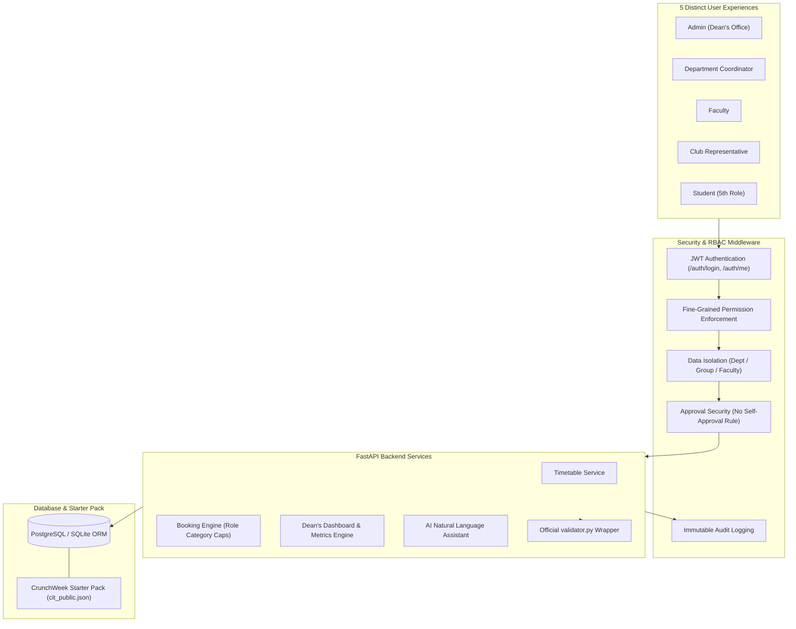

# Chilika Institute of Technology (CIT) — Campus Operations Platform

An Intelligent Campus Operations Platform engineered for Chilika Institute of Technology to generate conflict-free timetables, streamline venue bookings, resolve last-minute disruptions, and enforce robust role-based security.

---

## 1. Architecture & Security Overview

The platform is designed around a **Modular Monolith** architecture with server-side authentication, fine-grained permission control, data isolation, and audit logging.



### Core Security Pillars:
1. **Authentication:** Stateless JSON Web Tokens (JWT) signed with HS256, carrying user role, department, faculty ID, and student group claims.
2. **Authorization (RBAC):** 5 fully functional roles (`admin`, `department_coordinator`, `faculty`, `club`, `student`).
3. **Fine-Grained Permissions:** Endpoint-level permission dependencies (e.g. `booking:approve_all`, `timetable:generate`, `dashboard:dean`).
4. **Data Isolation:**
   - **Department Isolation:** Coordinators are restricted to their department's courses, student groups, and labs.
   - **Student Group Isolation:** Students can only view timetables and midsem exams for their assigned group (e.g., `Y1-A`).
   - **Faculty Isolation:** Faculty only see their teaching schedule and unavailability.
5. **Approval Security (No Self-Approval):** Strict server-side invariant preventing any user from approving their own booking or change requests, even if they possess administrative privileges.
6. **Audit Logging:** Every critical action (login attempts, booking creations, decisions, cancellations, schedule generation, and demo resets) is permanently written to the `audit_logs` table.

---

## 2. Tech Stack

- **Language:** Python 3.10+ (tested on Python 3.14)
- **Web Framework:** FastAPI
- **Data Validation & Settings:** Pydantic v2
- **ORM & Database:** SQLAlchemy 2.0 (PostgreSQL supported, SQLite for zero-setup local dev/test)
- **Token Security:** PyJWT + Bcrypt
- **Testing:** Pytest
- **Linting & Code Quality:** Ruff

---

## 3. Demo Accounts for All Five Roles

Judges and evaluators can log in using any of the pre-seeded demo accounts below (default password: `password123`):

| Role | Username | Email | Department / Scope | Description |
| :--- | :--- | :--- | :--- | :--- |
| **Admin** | `dean` | `dean@cit.edu` | `ADMIN` (Institutional) | Dean of Academics — Global control, generates timetables, institutional metrics. |
| **Department Coordinator** | `coord_cse` | `coordinator.cse@cit.edu` | `CSE` | Requests department changes, books dept rooms, approves CSE lab bookings. |
| **Faculty** | `f01` | `f01@cit.edu` | `CSE` (`F01` Dr. Ananya Mishra) | Views personal timetable, marks unavailability, requests moved classes. |
| **Club Representative** | `dramatics` | `dramatics@cit.edu` | Dramatics Society | Submits venue booking requests for fest week, tracks approval status. |
| **Student** | `student_y1a` | `student.y1a@cit.edu` | `COMMON` (Group `Y1-A`) | **5th Role** — Views group timetable, exam schedules, campus events. |

*(Additional accounts exist for coordinators `coord_ece`, `coord_me`, `coord_ee`, `coord_ce`, clubs `coding`, `robotics`, and all faculty `f01`-`f40`)*

### Demo Reset Mechanism:
Judges can reset the database to a clean starter-pack state at any time by calling:
- **API Endpoint:** `POST /api/v1/auth/reset-demo` (Authorized for `admin` role)
- All 27 rooms, 40 faculty, 14 student groups, 62 courses, 189 sessions, 25 booking requests, and 41 midsem exams are re-imported fresh from `cit_public.json`.

---

## 4. Setup & Running Instructions

### 1. Clone & Setup Virtual Environment
```bash
git clone <repo-url>
cd Tech_Zephyr4
python -m venv venv
# Windows:
venv\Scripts\activate
# Linux / macOS:
source venv/bin/activate
```

### 2. Install Dependencies
```bash
pip install -r requirements.txt
# Or using pyproject.toml:
pip install .
```

### 3. Environment Configuration
Copy `.env.example` to `.env`:
```bash
cp .env.example .env
```

### 4. Start the Backend Server
```bash
uvicorn app.main:app --host 0.0.0.0 --port 8000 --reload
```
Interactive Swagger API documentation will be available at:  
👉 **`http://localhost:8000/docs`**

---

## 5. Running Tests and Code Quality

### Run Automated Pytest Suite:
```bash
python -m pytest tests
```
Runs 12 comprehensive unit and integration tests covering:
- Authentication across all 5 roles
- RBAC route protection
- Data isolation (student group, faculty, coordinator)
- Approval security & No Self-Approval rule
- Role category capping
- Immutable audit log tracking

### Run Ruff Linter & Formatter:
```bash
python -m ruff check app tests
```

---

## 6. Official Validator Integration

The backend safely integrates the official `validator.py` as an isolated subprocess wrapper:
- Endpoint: `POST /api/v1/schedules/validate`
- Validates the current active schedule or custom payload against hard constraints (H1-H13, E1-E3) and computes soft penalties (S1-S6) and booking scores.

---

## 7. Known Limitations

1. **Solver Scalability:** The current baseline uses deterministic scheduling and fixed slot assignments; large multi-week rescheduling solver runs require configurable timeout buffers.
2. **Single Campus Realm:** Data models assume a single institution dataset (`cit-public-v1`).
