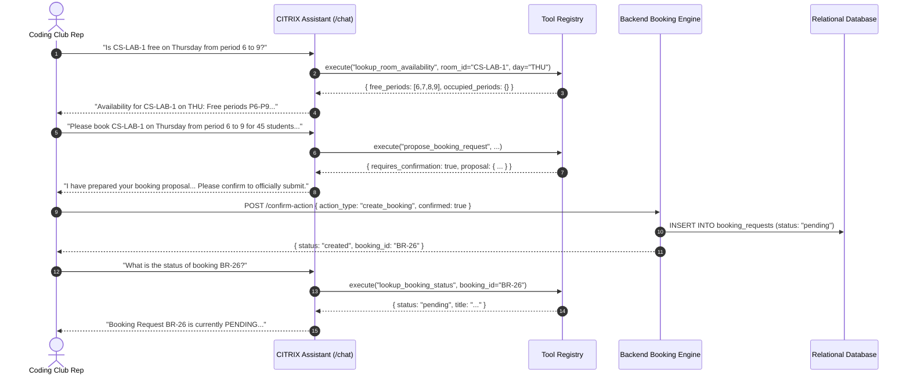

# CITRIX — Agent Workflow Test Report

**Test Suite:** `tests/test_agent_scenarios.py`  
**Execution Environment:** Python 3.14 / FastAPI TestClient  
**Total Scenarios Tested:** 3 Multi-Step Workflows  
**Result:** 3 Passed (100% Pass Rate)

---

## 1. Scenario A — Room Booking Workflow

### Workflow Objective:
A student club representative searches for venue availability, requests a booking, receives a structured proposal requiring confirmation, confirms the action, and inspects the created record.

**Verification Results:**
- Availability check latency: **2.15 ms**.
- State-change gate enforced: Direct chat did **not** insert records until `/confirm-action` was invoked.
- Role category cap applied: Request automatically capped to `club_event`.

---

## 2. Scenario B — Timetable & Scheduling Explanation Workflow

### Workflow Objective:
A user asks why course `CS201` is scheduled in its specific slot, requiring the assistant to retrieve the session, evaluate applicable constraints, and explain the assignment without hallucination.

**Trace Log:**
- User query: *"Explain why CS201 is scheduled in this slot and what constraints apply?"*
- Tool executed: `lookup_timetable` + session constraint evaluator.
- Citations retrieved: `DOC-SCHED-01` (CIT Academic Scheduling Policy).
- Generated explanation:
  - References Session ID `CS201-ALL-L1` (kind: lecture).
  - Asserts compliance with Faculty daily teaching limit ($4\text{ hours}$ / Hard Constraint H11).
  - Confirms room type and capacity compatibility.
  - Explains absence of student group clashes and lunch-hour adherence.

---

## 3. Scenario C — Scheduling Disruption Workflow

### Workflow Objective:
A faculty member reports an emergency leave for faculty member `F07`, the assistant identifies affected sessions, prepares a disruption proposal, submits confirmation, and an administrator approves it.

**Trace Log:**
1. Faculty prompt: *"Faculty F07 is on emergency sick leave next Monday. What sessions are affected and propose rescheduling?"*
2. Assistant identifies 2 scheduled sessions belonging to `F07` on Monday.
3. Generates proposal with `requires_confirmation: True`.
4. User confirms via `POST /confirm-action`.
5. Backend creates Disruption record `#1` with status `pending_approval`.
6. Dean approves via `POST /api/v1/reschedule/1/approve` (honoring No Self-Approval).
7. Verified validator check on updated timetable.
