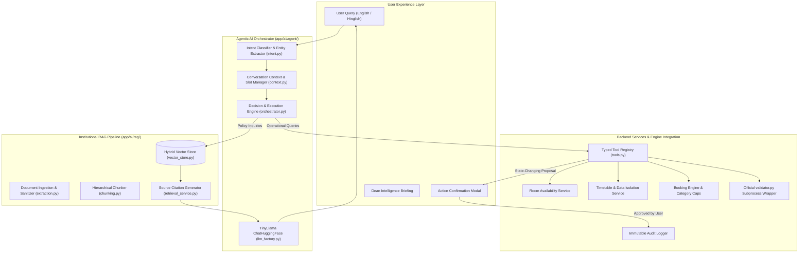

# CITRIX — AI Integration Architecture

## 1. Executive Summary

The **CITRIX — RAG & Agentic AI Module** serves as the intelligence layer for Chilika Institute of Technology (CIT), developed by Team Delta X. The architecture couples a **Hybrid Vector Store (BM25 + Semantic Search)** with an **Agentic AI Orchestrator** powered by `TinyLlama/TinyLlama-1.1B-Chat-v1.0` via `ChatHuggingFace` (`langchain_huggingface`).

The system ensures that the language model is **never authoritative for scheduling truth**. Instead, it acts as an intelligent reasoning and natural language interface that queries verified backend services, enforces deterministic constraint validations, respects server-side role permissions, and requires explicit human confirmation for state-changing operations.

---

## 2. Architectural Blueprint

---

## 3. Core Architectural Subsystems

### A. Intent Classification & Slot Filling (`intent.py`)
- Detects 9 core operational intents: `policy_question`, `room_search`, `booking_create`, `booking_status`, `timetable_lookup`, `exam_lookup`, `conflict_explanation`, `dean_summary`, and `reschedule_request`.
- Handles English and colloquial Hinglish (e.g. *"Kal shaam ko SH-1 khali hai kya?"*, *"Booking kyun reject hua?"*).
- Extracts entities: Rooms (`AUD`, `SH-1`, `CS-LAB-1`), Days (`MON`–`SAT`), Periods (`P1`–`P13`, `2 PM to 5 PM`), Attendance/Pax, Faculty IDs (`F01`–`F40`), and Student Groups (`Y1-A`, `Y2-CSE`).
- Triggers clarification questions when mandatory parameters are missing.

### B. Institutional RAG Pipeline (`retrieval_service.py` & `vector_store.py`)
- **Document Preprocessing:** Cleans and normalizes text; applies adversarial prompt injection defenses.
- **Hierarchical Chunking:** Preserves parent document metadata, page numbers, categories, and role restrictions.
- **Hybrid Vector Retrieval:** Combines BM25 lexical term weighting for exact campus codes with dense semantic token similarity.
- **Role Clearance Filtering:** Enforces that lower-privilege roles (students, clubs) cannot retrieve confidential or faculty/admin-only policy files.
- **Traceable Citations:** Returns structured metadata (`source_id`, `title`, `page`, `relevance_score`, `snippet`) for every retrieved knowledge reference.

### C. Typed Tool Registry (`tools.py`)
- Every operational capability is implemented as a typed Python function with input/output validation.
- Measures execution latency in milliseconds (`latency_ms`).
- Categorizes tools as:
  - **Read-Only:** Executed immediately if user possesses role clearance.
  - **State-Changing:** Returns a structured proposal with `requires_confirmation: True`.

### D. Human-in-the-Loop Confirmation Safeguard
- State-changing actions (creating bookings, applying disruptions) cannot commit mutations via conversational text alone.
- The assistant generates a structured proposal (`action_proposal`), which must be explicitly confirmed via `POST /api/v1/assistant/confirm-action` before the backend commits records or triggers the CP-SAT solver.

### E. CP-SAT & Validator Integration
- Connects to Chilika Institute of Technology's official `validator.py` via safe subprocess execution (`validator_service.py`).
- Explains hard violations (H1-H13) and soft penalties (S1-S6) in readable natural language without fabricating solver results.
